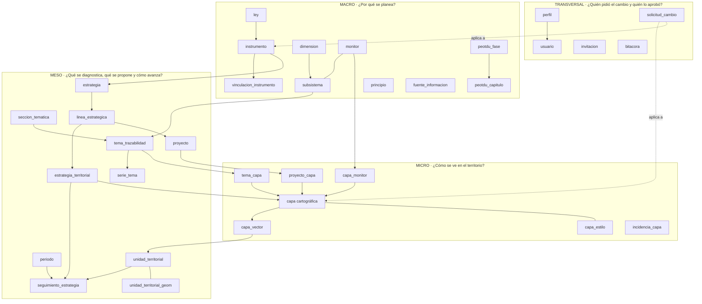
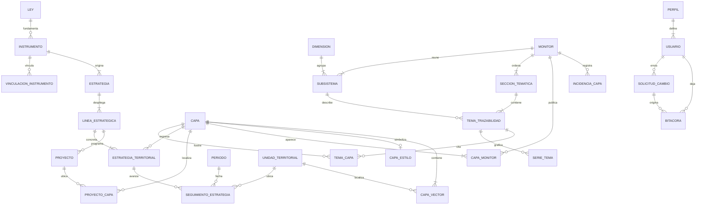

# SEOTDU — Arquitectura de datos

**Sistema:** Sistema Estatal de Ordenamiento Territorial y Desarrollo Urbano (Campeche) · Infraestructura pública digital
**Versión del documento:** 1.2 · octubre de 2026 · Etapa 4 (ver «Historial del documento» al final)
**Modelo de referencia:** *Arquitectura de Datos SESIM*. Se conservan su estructura (Macro / Meso / Micro / Transversal) y su regla de normalización de identificadores. Las piezas propias de SESIM se sustituyen por las del SEOTDU: el eje temático por el monitor, el indicador por la cartografía y la medición por la solicitud de cambio (Tabla 1a).
**Documentos hermanos:** `INTEGRACION-FRONTEND-BACKEND.md` (historial de cambios, matriz Frontend–Backend y flujo de estados de la interfaz) y `CLAUDE.md` (convenciones del código).

> **Cómo leer este documento.** Describe la base de datos destino (Supabase / PostgreSQL + PostGIS) y, en cada tabla, la columna **«Hoy»**: dónde vive ese dato mientras no existe el backend (Excel de `datos-fuente/` → script → JSON). Así sirve a la vez como especificación de la base y como mapa de la estructura actual del sistema. Las cifras se calcularon sobre los datos del repositorio en octubre de 2026.

---

## Índice

1. [Arquitectura lógica conceptual](#1-arquitectura-lógica-conceptual)
   - [1.1 MACRO: Gobernanza de datos (política pública)](#11-macro-gobernanza-de-datos-política-pública)
   - [1.2 MESO: Matriz de instrumentos y seguimiento del PEOTDU y territorio (transaccional)](#12-meso-matriz-de-instrumentos-y-seguimiento-del-peotdu-y-territorio-transaccional)
   - [1.3 MICRO: Operación geoespacial y vectores](#13-micro-operación-geoespacial-y-vectores)
   - [1.4 Seguridad y auditoría (transversal)](#14-seguridad-y-auditoría-transversal)
   - [1.5 Flujo transversal de usuarios institucionales y auditoría](#15-flujo-transversal-de-usuarios-institucionales-y-auditoría)
   - [1.6 Estados de una solicitud de cambio](#16-estados-de-una-solicitud-de-cambio)
2. [Diccionario de datos: composición de cada tabla](#2-diccionario-de-datos-composición-de-cada-tabla)
3. [Cardinalidad](#3-cardinalidad)
4. [Normalización de identificadores](#4-normalización-de-identificadores)
   - [4.1 Impacto en las llaves foráneas](#41-impacto-en-las-llaves-foráneas)
5. [Conexión entre tablas y su composición](#5-conexión-entre-tablas-y-su-composición)
6. [Adjetivos y verbos de las tablas](#6-adjetivos-y-verbos-de-las-tablas)
   - [6.1 Qué significa cada adjetivo](#61-qué-significa-cada-adjetivo)
   - [6.2 Lectura en lenguaje natural de las relaciones](#62-lectura-en-lenguaje-natural-de-las-relaciones)
7. [Funciones derivadas](#7-funciones-derivadas)
   - [7.1 Cruces con los datos actuales](#71-cruces-con-los-datos-actuales)
   - [7.2 Ejemplos de implementación](#72-ejemplos-de-implementación)
   - [7.3 Equivalencia de indicadores](#73-equivalencia-de-indicadores)

---

## 1. Arquitectura lógica conceptual

El sistema se organiza en tres niveles (Macro, Meso y Micro) y un módulo transversal de seguridad y auditoría. Se conserva la lectura en cascada del modelo SESIM, pero con los objetos propios del SEOTDU:

- **Macro:** por qué se planea. El instrumento, su ley y el **monitor**, que en el SEOTDU ocupa el lugar del eje temático.
- **Meso:** qué propone el PEOTDU y cómo se le da seguimiento. Cada estrategia territorial lleva su propio indicador.
- **Micro:** cómo se ve en el territorio. La **cartografía** ocupa el lugar que el indicador tenía en SESIM.
- **Transversal:** quién pidió cada cambio y quién lo aprobó.

El SEOTDU no mide un catálogo cerrado de indicadores, como SESIM. Su materia de trabajo es la **cartografía y los instrumentos de planeación**. Por eso:

- la capa ocupa el centro del modelo;
- el seguimiento se hace por **estrategia territorial**;
- lo que se audita son las **solicitudes de cambio** sobre capas e instrumentos.

El recorrido sigue al paradigma del PEOTDU. Los **7 subsistemas** se agrupan en **3 dimensiones** y se leen en **5 monitores**. Cada monitor tiene dos vistas:

- **Desempeño territorial (insumos):** el diagnóstico de 2024, descrito por la trazabilidad modular.
- **Estrategia territorial (salidas):** estrategias, acciones, indicadores y proyectos.



*Tabla 1. Descripción de los bloques*

| Bloque | Pregunta | Tablas | Función |
|---|---|---|---|
| **MACRO** · Gobernanza de datos | ¿Por qué se planea y bajo qué marco? | `ley`, `instrumento`, `vinculacion_instrumento`, `monitor`, `dimension`, `subsistema`, `peotdu_fase`, `peotdu_capitulo`, `principio`, `fuente_informacion` | Ordenamiento normativo y conceptual. Reglas estables: si cambia una ley o se publica un programa nuevo, solo este bloque se adapta. |
| **MESO** · Matriz de instrumentos y seguimiento del PEOTDU | ¿Qué se diagnostica, qué se propone, cuándo y dónde avanza? | `seccion_tematica`, `tema_trazabilidad`, `serie_tema`, `estrategia`, `linea_estrategica`, `estrategia_territorial`, `proyecto`, `periodo`, `unidad_territorial`, `unidad_territorial_geom`, `seguimiento_estrategia` | Núcleo de seguimiento. Une la narrativa del diagnóstico y las estrategias territoriales (cada una con su indicador) con el tiempo y la geografía oficial. |
| **MICRO** · Operación geoespacial | ¿Cómo se ve en el territorio? | `capa`, `capa_monitor`, `capa_estilo`, `capa_vector`, `tema_capa`, `proyecto_capa`, `incidencia_capa` | La cartografía. Separa el catálogo de capas de las geometrías masivas, dice en qué monitor y vista se publica cada capa y registra lo que aún no se puede desplegar. |
| **TRANSVERSAL** · Seguridad y auditoría | ¿Quién pidió el cambio, quién lo aprobó y con qué archivo? | `perfil`, `usuario`, `invitacion`, `solicitud_cambio`, `bitacora` | Acceso por perfil, dictamen de cada alta, modificación o baja, e historial inmutable. |

*Tabla 1a. Equivalencias con el modelo SESIM*

| SESIM | SEOTDU | Por qué |
|---|---|---|
| `eje_tematico` | `monitor` | Los monitores organizan todo el sistema: larguillos, geovisor y trazabilidad |
| `matriz_instrumento` + `indicador_instrumento` | `vinculacion_instrumento` | El SEOTDU no compara matrices de indicadores entre planes; relaciona instrumentos entre sí (la matriz de vinculación de la pirámide de planeación) |
| `indicador` (tabla maestra) | Campos de `estrategia_territorial` | Cada estrategia territorial trae su propio indicador, definición, método, meta y semáforo (§7.3) |
| `medicion_indicador` | `seguimiento_estrategia` | Lo que se registra es el avance de cada estrategia territorial por periodo y municipio |
| `capa_indicador` | `capa_monitor` | La capa se publica en uno o varios monitores y vistas; el MOT reutiliza capas de los otros monitores |
| `evidencia_medicion` | `solicitud_cambio` | Lo que se aprueba son altas, modificaciones y bajas de capas e instrumentos, cada una con su archivo |

### 1.1 MACRO: Gobernanza de datos (política pública)

Define por qué existe cada dato y bajo qué marco de competencia. Guarda reglas estratégicas estables.

- **Ley y orden de gobierno:** CPEUM, Ley de Planeación, LGAHOTDU, LGEEPA y LGMSV, con el orden Federal / Estatal / Municipal de la pirámide de planeación. *Hoy:* `src/data/sistemaPlaneacion.ts`.
- **Instrumento de planeación:** el catálogo rector. Son 35 programas: el PEOTDU y 34 instrumentos municipales y de centro de población (PDU, PMDU, POEL, POEPL), con su ficha técnica y sus enlaces de publicación. *Hoy:* `src/data/instrumentosData.ts` + `public/datos/publicaciones-instrumentos.json` (desde *Ficha-tecnica.xlsx*).
- **Matriz de vinculación entre instrumentos** (`vinculacion_instrumento`): sustituye a la *matriz de instrumento* y al *indicador–instrumento* de SESIM. Registra qué instrumento se alinea, se subordina o se coordina con cuál, y con qué fundamento (ley y artículo). Es la matriz de vinculación que hoy se muestra en «¿Qué es el sistema?». *Hoy:* `PYRAMID_TIERS` y referencias en `sistemaPlaneacion.ts`.
- **Monitor** (sustituye al eje temático): los 5 monitores en un orden único: Ambiental → Social → Infraestructura → Económico → Gobernanza (MOT). Cada monitor agrupa subsistemas, publica cartografía en el geovisor y ordena la trazabilidad. En el diagrama del paradigma, los monitores forman un **anillo exterior**, por fuera del de derechos humanos; cada sector se une con líneas tenues a los subsistemas que lo alimentan. *Hoy:* `MONITORES_INSUMOS` / `ORDEN_MONITORES` en `paradigmaPeotdu.ts` y `MODULES_CONFIG` en `appConfig.ts`.
- **Paradigma:** 3 dimensiones (Estructura, Desarrollo, Gobernanza territorial) y 7 subsistemas. *Hoy:* `DIMENSIONES` y `SUBSISTEMAS` en `paradigmaPeotdu.ts`.
- **Estructura del PEOTDU:** 5 fases y 10 capítulos con su página en el PDF oficial. *Hoy:* `src/data/peotduEstructura.ts`.
- **Principio rector:** los 5 principios de la matriz de estrategias (Ciudad compacta, densa y mixta; Equidad e inclusión; Ciudades sustentables y resilientes; Gestión integral de riesgos y desastres; Inclusión urbana).
- **Fuente de información:** la entidad que respalda cada dato (INEGI, CONABIO, CONANP, CENAPRED, SEMABICCE, OPMATPG…). Hoy va dentro del nombre del archivo de la capa (`C04_ANP_CONANP_2025`).

### 1.2 MESO: Matriz de instrumentos y seguimiento del PEOTDU y territorio (transaccional)

Es el núcleo de seguimiento y tiene dos caras, una por cada vista del geovisor.

- **Desempeño (insumos):** la **trazabilidad modular** describe cada tema del diagnóstico: descripción, variables, narrativa, analítica y series graficables. Se ordena como *monitor → sección temática → tema*. *Hoy:* `public/datos/trazabilidad-temas.json` (61 temas: 50 de diagnóstico y 11 de políticas del MOT; 18 series), desde *Trazabilidad modular-SEOTDU.docx*.
- **Estrategia (salidas):** la cadena *estrategia → línea estratégica → estrategia territorial*. Cada **estrategia territorial** es un renglón de *Estrategia-indicadores.xlsx*: una acción del PEOTDU, la capa sobre la que se expresa y, como atributos propios, su indicador, definición, método de cálculo, unidad de medida, frecuencia, línea base, meta, sentido y semaforización. Son 41. No se separa un catálogo de indicadores: cada estrategia trae los suyos, aunque varios se repitan (§7.3). *Hoy:* `public/datos/estrategia-indicadores.json`.
- **Proyecto:** la cartera de inversión del PEOTDU (32 proyectos), colgada de su línea estratégica y ubicada en una o más capas. *Hoy:* `public/datos/proyectos-seguimiento.json`.
- **Periodo y unidad territorial:** responden «¿cuándo?» y «¿dónde?». Las unidades son los 13 municipios y sus localidades (CVEGEO de INEGI), con la geometría aparte. *Hoy:* `campecheData.ts`, `localidadesUrbanas.ts`, `Lim_Mun_Base.json`.
- **Seguimiento de la estrategia** (sustituye a la *medición de indicador*): la tabla transaccional. Cada renglón es el valor del indicador de **una estrategia territorial** en **un periodo** y **una unidad territorial**, con su semáforo calculado. Se captura por solicitud de cambio, igual que una capa. Hoy está vacía: los 41 indicadores tienen la línea base «Por definir». La primera captura de cada estrategia fija su línea base.

### 1.3 MICRO: Operación geoespacial y vectores

Es la cartografía. Como en SESIM, separa el catálogo de capas (ligero, de carga instantánea) de las geometrías (masivas).

- **Capa cartográfica** (`capa`): el catálogo alfanumérico de 112 capas. Su `categoria` (*Diagnostico*, *Estrategia* o *Mapa_Base*) decide la vista en que se lista. *Hoy:* `public/layers/catalogo.json`.
- **Capa–monitor** (`capa_monitor`, sustituye a `capa_indicador`): dice en qué monitor, vista y rama se publica cada capa, en qué orden y si se enciende al abrir el monitor. Es muchos a muchos porque una misma capa aparece en su monitor y en el árbol E1–E4 del MOT (40 capas repetidas a propósito). *Hoy:* las secciones de `catalogo.json`, `defaultLayers` y el `arbol` del MOT en `appConfig.ts`.
- **Estilo:** la simbología exportada de QGIS, que pinta el mapa y genera la leyenda. *Hoy:* `public/estilos/**`.
- **Capa vector:** los elementos uno por uno: 53,125 en las 109 capas con archivo, en GeoJSON CRS84 (las otras 3 del catálogo no tienen archivo). *Hoy:* `public/layers/GeoJSON/**`.
- **Puentes:** `tema_capa` (el tema del diagnóstico se ilustra con la capa; nace del Word de trazabilidad y se completa con la hoja `vinculos-capa-tema.xlsx`) y `proyecto_capa` (el proyecto se ubica en la capa). La estrategia territorial apunta directo a su capa.
- **Incidencia de capa:** capas citadas en el PEOTDU que todavía no se pueden desplegar (archivo inexistente, tabla vacía, capa no identificada). Son 82. *Hoy:* `src/data/incidencias-cartografia.json`, desde *Incidencias EN CARTOGRAFIA - SEOTDU.xlsx*.

### 1.4 Seguridad y auditoría (transversal)

- **Perfil y usuario:** control de acceso por rol, que separa a quien captura de quien dictamina. La interfaz ya tiene los tres tableros (`src/components/perfiles/capturista`, `administradora`, `auditora`) y la ruta protegida `/admin-visor`.
- **Invitación:** token de un solo uso con el que el Administrador Titular da de alta a una persona con un perfil.
- **Solicitud de cambio** (sustituye a la *evidencia de medición*): cada alta, modificación o baja de una capa, un instrumento, una estrategia territorial, un proyecto o un seguimiento es una solicitud.
  - **Qué guarda:** los datos propuestos, el archivo (shapefile, GeoJSON o PDF) con su huella SHA-256, el motivo y el dictamen.
  - **Qué toca:** nada publicado cambia hasta que la solicitud se aprueba. Es la única puerta de entrada de contenido.
- **Bitácora:** registro automático, por disparadores, de cada cambio aplicado: tabla, registro, estado previo y nuevo, autor, solicitud que lo originó e IP.

### 1.5 Flujo transversal de usuarios institucionales y auditoría

1. **Preparación (Macro).** El Administrador mantiene los catálogos: instrumentos, monitores, subsistemas, principios y fuentes. Ninguna capa se registra sin monitor ni instrumento de origen.
2. **Solicitud (Capturista).** El Capturista de una dependencia o municipio sube una capa nueva, la actualización de una capa, un instrumento o el avance de una estrategia o un proyecto. Al **enviar**, se crea una `solicitud_cambio` en estado **en revisión**. El archivo se guarda en el depósito de pendientes, con su SHA-256; el contenido publicado no cambia.
3. **Dictamen (Administrador).** El Administrador ve la bandeja de solicitudes en revisión (`panel-dictamen.tsx`):
   - **Aprobar:** la función de dictamen aplica los datos a la tabla destino, mueve el archivo al depósito publicado y la solicitud pasa a **aprobada**. El cambio queda visible en el geovisor y en el catálogo.
   - **Rechazar:** comentario obligatorio. La solicitud pasa a **rechazada** y se borra el archivo pendiente. El renglón de la solicitud se conserva para la auditoría. Si el capturista corrige, envía una solicitud nueva.
4. **Publicación.** El contenido aprobado pasa a `publicado`. Solo lo publicado lo leen la página de inicio, el geovisor, el catálogo y el acceso vía MCP.
5. **Auditoría.** Cada solicitud y cada cambio aplicado quedan en `bitacora`. El Auditor, en modo de solo lectura, consulta el historial, verifica las huellas SHA-256 y registra hallazgos.

*Tabla 2. Perfiles institucionales y su alcance*

| Perfil | Qué hace | Escribe en | Lee |
|---|---|---|---|
| Capturista | Envía solicitudes de alta, modificación o baja, con su archivo | `solicitud_cambio` (solo las suyas, solo al crearlas) | Lo publicado y sus propias solicitudes |
| Administrador | Mantiene catálogos; dictamina solicitudes | Catálogos Macro; estado y dictamen de `solicitud_cambio` (y, por la función de dictamen, las tablas destino) | Todo |
| Administrador Titular | Lo anterior y, en exclusiva, invita y da de baja | Lo anterior + `invitacion`, baja en `usuario` | Todo |
| Auditor | Observa sin modificar; registra hallazgos | Solo hallazgos | Todo, incluida `bitacora` |
| Sistema (disparadores) | Registra cada cambio | `bitacora` (solo inserción) | — |

### 1.6 Estados de una solicitud de cambio

En SESIM, el estado vivía en la medición misma (borrador → revisión → vigente). En el SEOTDU se separan dos cosas. El **contenido publicado** (capa, instrumento, estrategia, proyecto, seguimiento) solo está publicado o dado de baja. La **solicitud de cambio** es la que recorre el flujo de aprobación. Así lo pendiente nunca convive con lo publicado y el geovisor no tiene que filtrar estados.

*Tabla 3. Estados de una solicitud*

| Estado | Qué significa | Quién lo asigna | Quién lo ve | Dónde vive el archivo |
|---|---|---|---|---|
| `en_revision` | Enviada; espera dictamen. Es lo que la interfaz hoy llama «En borradores» | Capturista, al enviar | Capturista, administradores, auditor | Depósito `pendientes` |
| `aprobada` | Aplicada al contenido publicado | Administrador | Todos los internos | Depósito `publicado` |
| `rechazada` | Devuelta con comentario obligatorio; no se aplica | Administrador | Capturista, administradores, auditor | Se borra; queda solo su huella SHA-256 |
| `cancelada` | Retirada por el capturista antes del dictamen | Capturista | Capturista, auditor | Se borra |

Transiciones válidas: `en_revision → aprobada | rechazada | cancelada`. Ninguna regresa: una corrección es una solicitud nueva que referencia a la anterior (`id_solicitud_previa`).

**Sobre el «borrador» del capturista.** No hace falta una tabla de borradores. Lo que la interfaz llama «En borradores» es la solicitud `en_revision`: pendiente de dictamen y visible para el Administrador. Si más adelante se quiere que el capturista guarde a medias sin enviar, basta un estado previo `en_edicion` en la misma tabla, visible solo para él. No se recomienda al inicio: el formulario de captura se llena y se envía en un solo paso.

**Contenido publicado.** Las tablas destino solo llevan `publicado boolean` (y `activo` para la baja lógica). Las vistas del esquema `api` filtran `publicado AND activo`.


---

## 2. Diccionario de datos: composición de cada tabla

Convenciones: **PK** llave primaria · **FK** llave foránea · **UQ** único · **N/S** nulo no/sí · `estado` (solo en `solicitud_cambio`) usa el dominio de la Tabla 3. Todas las tablas de contenido llevan `publicado` (boolean), `activo` (baja lógica), `id_solicitud` (→ `solicitud_cambio.id`, la que creó o cambió el registro por última vez), `creado_en` y `actualizado_en`; se omiten en las tablas siguientes.

### 2.1 ley

| Campo | Tipo | Llave | Nulo | Descripción |
|---|---|---|---|---|
| id | varchar(12) | PK | N | Siglas: `CPEUM`, `LP`, `LGAHOTDU`, `LGEEPA`, `LGMSV` |
| nombre | text | | N | Nombre oficial |
| orden_gobierno | text | CHECK | N | federal \| estatal \| municipal |
| url | text | | S | Publicación oficial |

*Hoy:* `LEYES` en `sistemaPlaneacion.ts`.

### 2.2 instrumento

| Campo | Tipo | Llave | Nulo | Descripción |
|---|---|---|---|---|
| id | varchar(24) | PK | N | Clave `TIPO-MUN-EDO-AÑO`: `PEOTDU-CAM-2023`, `PMDU-CAM-CAM-2020`, `POEL-HOP-CAM-2018` |
| nombre | text | | N | Nombre oficial |
| tipo | text | CHECK | N | PEOTDU \| PDU \| PMDU \| POEL \| POEPL |
| escala | text | CHECK | N | Estatal \| Municipal \| Centro de Población |
| id_unidad | varchar(9) | FK | S | → `unidad_territorial.id` (municipio). Vacío en el PEOTDU |
| ambito | text | | S | Política de gestión territorial, ecológica… |
| tipo_zonificacion | text | | S | Primaria, secundaria, UGA… |
| anio_publicacion | integer | | N | Año del decreto |
| version | text | CHECK | N | vigente \| caduco |
| vigencia | text | | S | «25 años» |
| dependencia | text | | N | AYUNTAMIENTO \| ESTADO |
| id_ley | varchar(12) | FK | S | → `ley.id`: fundamento del instrumento |
| link_publicacion | text | | S | Periódico Oficial |
| nota_publicacion | text | | S | Motivo cuando no hay enlace |
| link_repositorio | text | | S | Carpeta del repositorio institucional |
| link_pdf | text | | S | PDF servido por la plataforma |

*Hoy:* 35 registros: 1 PEOTDU, 12 PDU, 11 PMDU, 6 POEL y 4 POEPL de la ficha técnica, más PDU-HEC-CAM-2006, que no está en el catálogo. Hay 32 vigentes y 2 caducos.

**vinculacion_instrumento** (matriz de vinculación; sustituye a `matriz_instrumento` e `indicador_instrumento` de SESIM)

| Campo | Tipo | Llave | Nulo | Descripción |
|---|---|---|---|---|
| id_origen | varchar(24) | PK, FK | N | → `instrumento.id` |
| id_destino | varchar(24) | PK, FK | N | → `instrumento.id` |
| tipo | text | CHECK | N | se_alinea \| se_subordina \| se_coordina \| deroga |
| id_ley | varchar(12) | FK | S | → `ley.id` |
| articulo | text | | S | Artículo que fundamenta el vínculo |
| nota | text | | S | |

*Hoy:* la matriz de vinculación del apartado «¿Qué es el sistema?» (`PYRAMID_TIERS` en `sistemaPlaneacion.ts`) vincula niveles de la pirámide, no instrumentos concretos. Al migrar, cada PMDU se vincula con el PEOTDU y con el POEL de su municipio.

### 2.3 peotdu_fase y peotdu_capitulo

| Campo | Tipo | Llave | Nulo | Descripción |
|---|---|---|---|---|
| fase.numero | smallint | PK | N | 1 a 5: Fundamentación, Diagnóstico integral, Prospectiva, Estrategia de implementación, Seguimiento y evaluación |
| fase.nombre | text | | N | |
| capitulo.numero | smallint | PK | N | 1 a 10 |
| capitulo.romano | text | | N | I … X |
| capitulo.titulo / corto | text | | N | Nombre completo y nombre para el índice |
| capitulo.fase | smallint | FK | N | → `peotdu_fase.numero` |
| capitulo.pagina | integer | | N | Página de inicio en el PDF oficial |
| capitulo.id_monitor | varchar(16) | FK | S | Monitor que lo desarrolla en el geovisor |

### 2.4 dimension, subsistema y monitor

| Tabla.campo | Tipo | Llave | Nulo | Descripción |
|---|---|---|---|---|
| dimension.id | varchar(12) | PK | N | `estructura` \| `desarrollo` \| `gobernanza` |
| dimension.nombre / color / explicacion | text | | N | Color: #2E8C8A, #2C5D86, #D2873A |
| subsistema.id | varchar(20) | PK | N | `fisico-natural`, `urbano-rural`, `movilidad`, `economico`, `patrimonio`, `sociodemografico`, `institucional` |
| subsistema.id_dimension | varchar(12) | FK | N | → `dimension.id` (agrupación **provisional**, por confirmar) |
| subsistema.id_monitor | varchar(16) | FK | N | → `monitor.id`, el monitor que lo agrupa (sector del anillo de monitores) |
| subsistema.id_monitor_insumos | varchar(16) | FK | S | Monitor del geovisor que abre en Desempeño cuando sus capas viven en otro: Institucionalidad → `infraestructura` |
| subsistema.numero_fachada | smallint | UQ | N | 1 a 7: fachada del larguillo de insumos |
| subsistema.descripcion | text | | N | |
| monitor.id | varchar(16) | PK | N | `ambiental`, `social`, `infraestructura`, `aptitud`, `normatividad`. Sustituye a `eje_tematico` de SESIM |
| monitor.nombre | text | | N | «Monitor Ambiental» … «Monitor de Gobernanza (MOT)» |
| monitor.orden | smallint | UQ | N | 1 a 5: orden único de los larguillos y del geovisor |
| monitor.color / tinta | text | | N | #77923B, #006FC0, #C00000, #FFC000, #1C334E |

*Agrupación vigente:*
- Ambiental = Físico natural
- Social = Sociodemográfico, Patrimonio
- Infraestructura = Urbano-rural, Movilidad
- Económico = Económico
- Gobernanza (MOT) = Institucionalidad y gobernanza

### 2.5 principio y fuente_informacion

| Campo | Tipo | Llave | Nulo | Descripción |
|---|---|---|---|---|
| principio.id | smallint | PK | N | |
| principio.nombre | text | UQ | N | 5 principios de la matriz de indicadores |
| fuente.id | varchar(16) | PK | N | `INEGI`, `CONABIO`, `CONANP`, `CENAPRED`, `SEMABICCE`, `OPMATPG`… |
| fuente.nombre / url | text | | N/S | Entidad acreditada |

### 2.6 seccion_tematica y tema_trazabilidad

| Campo | Tipo | Llave | Nulo | Descripción |
|---|---|---|---|---|
| seccion.id | varchar(40) | PK | N | slug `monitor-seccion` |
| seccion.id_monitor | varchar(16) | FK | N | Monitor de la trazabilidad (Ambiental, Social, Infraestructura, Económico, MOT) |
| seccion.nombre | text | | N | «Medio físico», «Servicios ecosistémicos», «Gobernanza institucional»… (21 secciones) |
| tema.id | varchar(120) | PK | N | slug `monitor-seccion-titulo` |
| tema.id_seccion | varchar(40) | FK | N | → `seccion_tematica.id` |
| tema.id_subsistema | varchar(20) | FK | N | → `subsistema.id` |
| tema.vista | text | CHECK | N | `desempeno` (diagnóstico) \| `estrategia` (políticas del MOT) |
| tema.titulo / tema | text | | N | Título y subtema |
| tema.descripcion | text | | S | «En este tema la variable corresponde a…» |
| tema.variables | text | | S | Variables analizadas |
| tema.capas_texto | text | | S | Capas citadas tal como vienen en el Word |
| tema.narrativa | text | | S | Pestaña **Narrativa** |
| tema.analitica | text | | S | Pestaña **Analítica**; viñetas «Título: texto» = tarjetas de cifras |

*Hoy:* 61 temas (50 `desempeno` + 11 `estrategia`), generados con `scripts/extraer-trazabilidad.py`.

### 2.7 serie_tema

| Campo | Tipo | Llave | Nulo | Descripción |
|---|---|---|---|---|
| id | serial | PK | N | |
| id_tema | varchar(120) | FK | N | → `tema_trazabilidad.id` |
| titulo | text | | N | «Dos provincias fisiográficas en Campeche» |
| unidad | text | | S | %, km², hab… |
| tipo | text | CHECK | N | categoria \| anio: barras horizontales o columnas |
| datos | jsonb | | N | `[{ "etiqueta": "Península de Yucatán", "valor": 78 }, …]` |

*Hoy:* 18 series dentro del JSON de temas. Se sustituirán por `v_serie_indicador` cuando haya mediciones.

### 2.8 estrategia y linea_estrategica

| Campo | Tipo | Llave | Nulo | Descripción |
|---|---|---|---|---|
| estrategia.id | varchar(6) | PK | N | Clave: `STA` (E1 Selva, tierra y agua), `CMTB` (E2 Campo, mar y turismo biocultural), `CHB` (E3 Comunidades, hogar y bienestar), `ITDUI` (E4 Integración territorial, desarrollo urbano e industria) |
| estrategia.numero | smallint | UQ | N | 1 a 4 |
| estrategia.nombre | text | | N | |
| estrategia.id_instrumento | varchar(24) | FK | N | → `instrumento.id` (`PEOTDU-CAM-2023`) |
| linea.id | varchar(6) | PK | N | `1.1` … `4.2` (hoy 9 líneas con estrategia territorial) |
| linea.id_estrategia | varchar(6) | FK | N | |
| linea.nombre | text | | N | «Protección y recualificación de la biodiversidad…» |

### 2.9 estrategia_territorial

Un renglón de *Estrategia-indicadores.xlsx*: una acción del PEOTDU expresada sobre una capa, **con su propio indicador**. Sustituye a la pareja `accion` + `indicador` maestro de SESIM. No hay catálogo de indicadores aparte: cada estrategia territorial lleva su definición completa. Las repeticiones se controlan con una vista de consistencia (§7.3), no con una llave foránea.

| Campo | Tipo | Llave | Nulo | Descripción |
|---|---|---|---|---|
| id | varchar(12) | PK | N | Clave de estrategia + consecutivo: `STA-01` … `ITDUI-14` |
| id_linea | varchar(6) | FK | N | → `linea_estrategica.id` |
| accion | text | | N | «Acción 1.1.14 Crear cinturones verdes…» |
| numero_accion | varchar(10) | | S | `1.1.14` |
| id_principio | smallint | FK | N | → `principio.id` |
| clave_capa | varchar(80) | | N | `capa.clave_norm` de la capa sobre la que se expresa |
| dimension | text | CHECK | N | Eficiencia \| Calidad \| Eficacia |
| indicador | text | | N | Nombre del indicador |
| definicion | text | | N | Qué mide |
| metodo_calculo | text | | N | Fórmula |
| unidad_medida | text | | N | Número de proyectos, Porcentaje… |
| unidad_analisis | text | | N | Estatal y municipal |
| frecuencia | text | | N | 3, 4 o 5 años |
| linea_base | numeric | | S | Hoy «Por definir» en las 41; la fija el primer seguimiento aprobado |
| linea_aprobatoria | numeric | | S | |
| meta | text | | N | «Incrementar respecto a la línea base» |
| meta_numerica | numeric | | S | Cuando la meta sea cuantificable |
| sentido | text | CHECK | N | ascendente \| descendente |
| semaforizacion | jsonb | | N | `{"verde":">= meta","amarillo":"75-99 %","rojo":"< 75 %"}` |
| justificacion | text | | S | Justificación urbana / ambiental |
| responsable | text | | S | Dependencias responsables |
| id_fuente | varchar(16) | FK | S | |
| grupo_indicador | varchar(8) | | S | `IND-01` … para agrupar indicadores iguales en reportes (§7.3) |

### 2.10 proyecto

| Campo | Tipo | Llave | Nulo | Descripción |
|---|---|---|---|---|
| id | varchar(10) | PK | N | `STA-001`, `CMTB-007`: clave de estrategia + consecutivo |
| id_linea | varchar(6) | FK | N | → `linea_estrategica.id` |
| id_monitor | varchar(16) | FK | N | Monitor donde se publica |
| nombre | text | | N | |
| ubicacion | text | | S | «Xpujil, Calakmul» |
| monto | numeric(16,2) | | S | MXN |
| inversion_publica / privada | boolean | | N | |
| plazo | text | CHECK | N | corto \| mediano \| largo |
| prioridad | text | CHECK | S | alta \| media \| baja |
| responsable / coordinacion | text | | S | |
| poblacion_beneficiada | text | | S | |
| financiamiento | text | | S | |
| avance | numeric(5,2) | | S | % de avance físico; se actualiza por solicitud de cambio |

*Hoy:* 32 proyectos: 11 Económico, 9 Infraestructura, 7 Ambiental y 5 Social. De ellos, 28 tienen capa ligada (30 capas distintas).

### 2.11 periodo

| Campo | Tipo | Llave | Nulo | Descripción |
|---|---|---|---|---|
| id | integer | PK | N | |
| anio | integer | | N | |
| etiqueta | text | UQ | N | «2024», «2026-T1» |
| tipo_periodo | text | CHECK | S | anual \| trienal \| cuatrienal \| quinquenal |
| fecha_inicio / fecha_fin | date | | S | |

### 2.12 unidad_territorial y unidad_territorial_geom

| Campo | Tipo | Llave | Nulo | Descripción |
|---|---|---|---|---|
| id | varchar(9) | PK | N | CVEGEO INEGI: 5 dígitos (municipio, 04001–04013) o 9 (localidad) |
| id_padre | varchar(9) | FK | S | Municipio de la localidad |
| nivel | text | CHECK | N | estado \| municipio \| localidad |
| nombre | text | | N | |
| tipo | text | CHECK | S | urbana (≥ 2,500 hab.) \| rural |
| pob_tot | integer | | S | Censo 2020 |
| anio_creacion | integer | | S | Decreto de creación (estado: 1863) |
| pib_participacion | numeric | | S | % de la economía estatal |
| geom.id_unidad | varchar(9) | PK, FK | N | 1 a 0..1 |
| geom.geom | geometry(MultiPolygon, 4326) | | N | Límite oficial |

*Hoy:* `campecheData.ts`, `indicadoresTerritoriales.ts`, `localidadesUrbanas.ts` y `Lim_Mun_Base.json`.

### 2.13 seguimiento_estrategia

Tabla transaccional; sustituye a `medicion_indicador`. Cada renglón es el valor del indicador de una estrategia territorial en un periodo y una unidad territorial.

| Campo | Tipo | Llave | Nulo | Descripción |
|---|---|---|---|---|
| id | uuid | PK | N | |
| id_estrategia_territorial | varchar(12) | FK | N | → `estrategia_territorial.id` |
| id_periodo | integer | FK | N | |
| id_unidad | varchar(9) | FK | N | Municipio o estado |
| valor | numeric | | S | |
| valor_texto | text | | S | Cuando el avance es cualitativo |
| semaforo | text | GENERATED | S | Calculado con `fn_semaforo` (§7.2) |
| nota | text | | S | Contexto del avance |
| id_solicitud | uuid | FK | N | Solicitud que lo capturó (archivo de respaldo y dictamen) |
| UQ | | | | (`id_estrategia_territorial`, `id_periodo`, `id_unidad`) |

Una corrección no sobrescribe el valor. Entra por una solicitud nueva y la bitácora conserva el anterior.

### 2.14 seccion_capa (y mapa)

| Campo | Tipo | Llave | Nulo | Descripción |
|---|---|---|---|---|
| mapa.id | varchar(16) | PK | N | `mapa_base` + los 5 monitores. Es la cara cartográfica del monitor; puede fundirse con `monitor` añadiendo el Mapa Base como monitor sin vista |
| mapa.id_monitor | varchar(16) | FK | S | Vacío en Mapa Base |
| mapa.carpeta / titulo | text | | N | `01_Ambiental` / «Ambiental» |
| seccion.id | varchar(40) | PK | N | |
| seccion.id_mapa | varchar(16) | FK | N | |
| seccion.titulo | text | | N | «Medio físico natural», «Selva, tierra y agua»… |
| seccion.eje | text | | S | `desempeno_territorial` \| `estrategia_territorial` |

### 2.15 capa (capa cartográfica)

| Campo | Tipo | Llave | Nulo | Descripción |
|---|---|---|---|---|
| id | varchar(80) | PK | N | Nombre de archivo en minúsculas: `c04_erosionsuelo_inegi_2014` |
| clave_norm | varchar(80) | UQ | N | `norm(id)` (§4); une la capa con el Word, los Excel y QGIS |
| nombre_original | text | | S | Nombre de QGIS: `C04_ErosionSuelo_INEGI_2014` |
| titulo | text | | N | Nombre legible (`nombreCapaLegible`) |
| id_seccion | varchar(40) | FK | N | → `seccion_capa.id` |
| categoria | text | CHECK | N | Diagnostico \| Estrategia \| Mapa_Base |
| vista | text | GENERATED | S | `desempeno` si Diagnóstico, `estrategia` si Estrategia |
| tipo_geometria | text | CHECK | N | Point \| LineString \| Polygon (y Multi) |
| srid_origen | integer | | N | 6372, 32615, 4326… |
| id_fuente | varchar(16) | FK | S | |
| id_instrumento | varchar(24) | FK | S | `PEOTDU-CAM-2023` en Diagnóstico y Estrategia |
| anio | integer | | S | Año del dato |
| archivo / ruta | text | | N | Ruta del GeoJSON |
| fija | boolean | | N | Se dibuja con su módulo sin control propio (límites, búfer) |
| excluida | boolean | | N | No se muestra (estilo no traducible o sin atributos) |
| n_elementos | integer | | N | Elementos en `capa_vector` |
| metadatos_extra | jsonb | | S | ISO 19115: linaje, escala nominal, denominador de escala, periodicidad… |

### 2.16 capa_estilo

| Campo | Tipo | Llave | Nulo | Descripción |
|---|---|---|---|---|
| id_capa | varchar(80) | PK, FK | N | |
| simbologia | jsonb | | N | Renderer de QGIS (único, categorizado, graduado, reglas) |
| etiquetas | jsonb | | S | Rótulos por zoom |
| origen | text | | N | Archivo de volcado de QGIS |

### 2.17 capa_vector

| Campo | Tipo | Llave | Nulo | Descripción |
|---|---|---|---|---|
| id | uuid | PK | N | |
| id_capa | varchar(80) | FK | N | |
| id_unidad | varchar(9) | FK | S | Unidad territorial donde cae (localidad o municipio) |
| id_origen | text | | N | Identificador en el archivo fuente |
| nombre / clasif | text | | S | Atributos comunes de lectura y simbología |
| propiedades | jsonb | | N | Atributos temáticos (SCINCE, DENUE…) |
| geom | geometry(Geometry, 4326) | | N | GIST |

*Hoy:* 53,125 elementos en las 109 capas con archivo. Por mapa: Mapa Base 25,220; Infraestructura 15,200; Económico 8,318; Ambiental 3,761; Social 586; MOT 40.

### 2.18 capa_monitor y puentes tema_capa, proyecto_capa

**capa_monitor** (sustituye a `capa_indicador` de SESIM). Dice dónde se publica cada capa.

| Campo | Tipo | Llave | Nulo | Descripción |
|---|---|---|---|---|
| id_capa | varchar(80) | PK, FK | N | → `capa.id` |
| id_monitor | varchar(16) | PK, FK | N | → `monitor.id` (o `mapa_base`) |
| vista | text | CHECK | S | `desempeno` \| `estrategia`; vacío en Mapa Base |
| rama | text | | S | En el MOT: `E1 · Selva, tierra y agua` / línea `1.1`… |
| orden | smallint | | N | Orden en la caja |
| encendida_por_omision | boolean | | N | Se enciende al abrir el monitor (`defaultLayers`) |
| grupo | text | | S | Grupo de capas que se encienden juntas (`groups` de `appConfig.ts`) |

*Hoy:* 112 asignaciones del catálogo + 40 del árbol E1–E4 del MOT.

| Puente | Campos | Llave | Lectura |
|---|---|---|---|
| tema_capa | id_tema, clave_capa, orden, origen (`word` \| `hoja_vinculos`), validado_por | PK (id_tema, clave_capa) | El tema del diagnóstico **se ilustra con** la capa |
| proyecto_capa | id_proyecto, clave_capa | PK (id_proyecto, clave_capa) | El proyecto **se ubica en** la capa |

Los puentes, y `estrategia_territorial.clave_capa`, usan `clave_capa = capa.clave_norm` y no `capa.id`. Así una capa citada que aún no existe se registra igual y se resuelve sola cuando la capa se publica (§4.1).

### 2.19 incidencia_capa

| Campo | Tipo | Llave | Nulo | Descripción |
|---|---|---|---|---|
| id | serial | PK | N | |
| clave_capa | varchar(80) | | S | `norm(archivo)`; vacío si la capa no se identificó |
| id_monitor | varchar(16) | FK | N | |
| id_subsistema | varchar(20) | FK | S | |
| tematica | text | | S | Tema de la trazabilidad al que pertenece |
| nombre | text | | N | |
| archivo | text | | S | |
| vista | text | CHECK | N | `desempeno` \| `estrategia` (los «Proyecto: …» de la EEMSV) |
| estatus | text | CHECK | N | archivos_inexistentes \| tabla_vacia \| no_identificada \| pendiente \| resuelta |
| incidencia / observaciones | text | | S | |
| resuelta_en | date | | S | Se llena al publicar la capa |

*Hoy:* 82 incidencias: 64 por archivo inexistente, 14 capas no identificadas, 1 tabla vacía (Karst) y 3 pendientes. De ellas, 13 recibieron el monitor por la regla de respaldo del script (`R04_*` → Ambiental; «Sistema de ciudades» → Infraestructura, Estrategia) y lo indican en `observaciones`.

### 2.20 solicitud_cambio

Sustituye a `evidencia_medicion` de SESIM. Es la única puerta de entrada de contenido (§1.5).

| Campo | Tipo | Llave | Nulo | Descripción |
|---|---|---|---|---|
| id | uuid | PK | N | |
| tipo | text | CHECK | N | alta \| modificacion \| baja |
| objeto | text | CHECK | N | capa \| instrumento \| estrategia_territorial \| proyecto \| seguimiento \| tema |
| id_objeto | text | | S | Registro afectado; vacío en un alta |
| id_monitor | varchar(16) | FK | S | Monitor al que pertenece (para la bandeja del administrador) |
| datos_propuestos | jsonb | | N | Los campos tal como quedarían |
| datos_previos | jsonb | | S | Copia del registro al momento de la solicitud (modificación y baja) |
| archivo_url | text | | S | Depósito `pendientes`; al aprobar, `publicado` |
| archivo_nombre | text | | S | Nombre original del archivo |
| hash_archivo | char(64) | | S | SHA-256; se conserva aunque el archivo se borre |
| motivo | text | | N | Por qué se pide el cambio |
| estado | text | CHECK | N | en_revision \| aprobada \| rechazada \| cancelada (Tabla 3) |
| id_capturista | uuid | FK | N | Quien la envía |
| enviada_en | timestamptz | | N | |
| id_dictaminador | uuid | FK | S | Obligatorio en `aprobada` y `rechazada` |
| dictaminada_en | timestamptz | | S | |
| comentario_dictamen | text | | S | Obligatorio en `rechazada` |
| id_solicitud_previa | uuid | FK | S | La rechazada que esta corrige |

*Hoy:* el tablero del capturista muestra las bandejas «En borradores» (= `en_revision`) y «Aprobados», y `panel-dictamen.tsx` ya pide comentario al rechazar. Los datos todavía son de ejemplo.

### 2.21 perfil, usuario, invitacion y bitacora

| Tabla.campo | Tipo | Llave | Nulo | Descripción |
|---|---|---|---|---|
| perfil.id | smallint | PK | N | capturista \| administrador \| administrador_titular \| auditor |
| usuario.id | uuid | PK | N | `auth.users` de Supabase |
| usuario.id_perfil | smallint | FK | N | |
| usuario.dependencia / id_unidad | text / varchar(9) | FK | S | Ámbito de captura |
| usuario.activo | boolean | | N | Baja lógica |
| invitacion.token_hash | text | UQ | N | Solo el hash del token |
| invitacion.id_perfil / expira / usada_en / id_usuario_creado | | FK | | |
| bitacora.id | bigserial | PK | N | Solo inserción |
| bitacora.tabla / id_registro / accion / antes / despues | | | | `antes` y `despues` en jsonb |
| bitacora.id_usuario / id_solicitud / ip / en | | FK | | Quién, por qué solicitud, desde dónde y cuándo |

---

## 3. Cardinalidad

*Tabla 4. Relaciones*

| Relación | Cardinalidad | Lectura |
|---|---|---|
| ley → instrumento | 1 : N | Una ley fundamenta muchos instrumentos |
| instrumento ↔ instrumento | N : M (`vinculacion_instrumento`) | Matriz de vinculación: un PMDU se alinea con el PEOTDU y con su POEL |
| unidad_territorial (municipio) → instrumento | 1 : 0..N | Un municipio tiene de 0 a varios PDU / PMDU / POEL |
| peotdu_fase → peotdu_capitulo | 1 : N | 5 fases, 10 capítulos |
| dimension → subsistema | 1 : N | 3 → 7 |
| monitor → subsistema | 1 : 1..N | 5 monitores agrupan los 7 subsistemas |
| monitor → seccion_tematica | 1 : N | 21 secciones temáticas |
| seccion_tematica → tema_trazabilidad | 1 : N | 61 temas |
| subsistema → tema_trazabilidad | 1 : N | Físico natural tiene 15 temas; Movilidad, 3 |
| tema_trazabilidad → serie_tema | 1 : 0..N | 18 series en 12 temas |
| tema_trazabilidad ↔ capa | N : M (`tema_capa`) | 119 capas citadas; un tema cita hasta 13 capas |
| instrumento → estrategia | 1 : N | El PEOTDU → 4 estrategias |
| estrategia → linea_estrategica → estrategia_territorial | 1 : N : N | 4 → 9 → 41 |
| capa → estrategia_territorial | 1 : 0..N | Hoy 1 : 1 (41 capas) |
| estrategia_territorial → seguimiento_estrategia | 1 : 0..N | Un valor por periodo y unidad territorial |
| periodo / unidad_territorial → seguimiento_estrategia | 1 : 0..N | |
| linea_estrategica → proyecto | 1 : N | 32 proyectos |
| proyecto ↔ capa | N : M (`proyecto_capa`) | 28 proyectos con capa, 30 capas |
| capa ↔ monitor | N : M (`capa_monitor`) | 112 asignaciones + 40 del árbol del MOT |
| capa → capa_estilo | 1 : 0..1 | |
| capa → capa_vector | 1 : N | 53,125 elementos |
| unidad_territorial → capa_vector | 1 : 0..N | Cada elemento cae en una unidad |
| unidad_territorial → unidad_territorial_geom | 1 : 0..1 | |
| monitor → incidencia_capa | 1 : N | 82 incidencias |
| usuario (capturista) → solicitud_cambio | 1 : N | |
| solicitud_cambio → registro de contenido | 1 : 0..1 | Una solicitud aprobada crea, cambia o da de baja un registro |
| solicitud_cambio → solicitud_cambio | 0..1 : 0..1 | Una corrección referencia a la rechazada |
| solicitud_cambio → bitacora | 1 : N | |
| perfil → usuario | 1 : N | |
| usuario → bitacora | 1 : N | |



---

## 4. Normalización de identificadores

La misma capa llega con cuatro nombres distintos:

| Origen | Ejemplo |
|---|---|
| Volcado de QGIS (estilos) | `C04_ANP_Río_Candelaria_OPMATPG_2023` |
| Archivo GeoJSON (catálogo) | `c04_anp_rio_candelaria_opmatpg_2023` |
| Word de trazabilidad | `C04_ANPRioCandelaria_OPMATPG_2023` (sin guiones, en CamelCase) |
| Excel de estrategia / proyectos / incidencias | `C04_ANP_Río_Candelaria_OPMATPG_2023.shp` o el nombre legible |

**Regla única (`norm`).** Se descompone a NFKD, se quitan los acentos, se pasa a minúsculas y se elimina todo lo que no sea `[a-z0-9]`:

```
C04_ANP_Río_Candelaria_OPMATPG_2023  →  c04anpriocandelariaopmatpg2023
```

La regla está implementada en tres sitios, con el mismo resultado:

- `src/lib/cartografia.ts → norm()`
- la copia local en `module-layer-selector.tsx`
- `norm()` en `scripts/*.py`

En la base será una función inmutable, `api.norm(text)`, y una columna `capa.clave_norm` con índice único.

*Tabla 5. Convención de identificadores por tabla*

| Tabla | Formato | Ejemplo |
|---|---|---|
| instrumento | `TIPO-MUN-EDO-AÑO` | `PMDU-CHAM-CAM-2024` |
| estrategia | clave del PEOTDU | `STA`, `CMTB`, `CHB`, `ITDUI` |
| linea_estrategica | numeración del PEOTDU | `1.3` |
| estrategia_territorial | `CLAVE-NN` | `STA-01` |
| grupo_indicador (reportes) | `IND-NN` | `IND-01` |
| solicitud_cambio | uuid | — |
| proyecto | `CLAVE-NNN` | `STA-001` |
| subsistema / monitor / dimension | slug | `fisico-natural`, `aptitud`, `gobernanza` |
| seccion / tema | slug `monitor-seccion[-titulo]` | `ambiental-medio-fisico-provincias-fisiograficas` |
| capa | archivo en minúsculas + `clave_norm` | `c04_karst_cenapred_2023` / `c04karstcenapred2023` |
| unidad_territorial | CVEGEO INEGI | `04002`, `040020001` |

### 4.1 Impacto en las llaves foráneas

- **Puentes por `clave_norm`.** `tema_capa`, `proyecto_capa`, `incidencia_capa` y `estrategia_territorial` referencian la clave normalizada, no el id. Así un tema puede citar una capa todavía no publicada, una incidencia se cierra sola al publicarla (`v_incidencias_abiertas`) y no se rompe ningún vínculo al renombrar el archivo.
- **Validación.** Cada puente tiene un disparador que avisa (no bloquea) cuando la clave no existe en `capa`. Hoy 60 claves citadas en la trazabilidad no están en el catálogo; casi todas aparecen en la tabla de incidencias.
- **Legibilidad.** `capa.nombre_original` conserva la forma con mayúsculas, que da mejores nombres legibles que el archivo en minúsculas (`EROSIONSUELO` frente a `Erosión de suelo`).
- **Datos externos.** El monitor del Excel de incidencias («Económico», «MOT») se traduce al id del módulo (`aptitud`, `normatividad`) en `scripts/extraer-incidencias.py`; la base lo hará con un catálogo de alias de `monitor`.
- **Doble codificación.** Algunos nombres llegan como «Champotón». `repararCodificacion()` (`textoLegible.ts`) los corrige en la interfaz; en la carga a la base se corrigen una sola vez.

---

## 5. Conexión entre tablas y su composición

Tres recorridos explican casi todas las consultas de la interfaz:

**A. Larguillo de subsistemas → geovisor en Desempeño**

```
subsistema ─< tema_trazabilidad (vista = desempeno) ─< tema_capa >─ capa (categoria = Diagnostico)
   │                    │                                                │
   └─ monitor ─< capa_monitor (vista = desempeno)  └─ serie_tema          └─< capa_vector
```

La fachada «Físico natural» abre 15 temas. Las capas que citan y que el geovisor publica en Diagnóstico son 8; «Encender sus 8 capas» las enciende con `/geovisor?modulo=ambiental&vista=desempeno&subsistema=fisico-natural&capas=…`.

**B. Panel de una capa de estrategia**

```
capa ─< estrategia_territorial (indicador, meta, semáforo) >─ linea_estrategica >─ estrategia >─ instrumento
              │
              └─< seguimiento_estrategia >─ periodo, unidad_territorial
capa ─< proyecto_capa >─ proyecto
```

**C. Caja de un monitor en el geovisor**

```
monitor ─< capa_monitor >─ capa (publicado)
              ├─ vista = desempeno  ∧  tema con narrativa y analítica  → se lista en Desempeño
              ├─ vista = estrategia                                    → se lista en Estrategia
              └─ incidencia_capa (abierta)                             → «Capas pendientes de publicar»
```

**D. Solicitud de cambio → contenido publicado**

```
capturista ─< solicitud_cambio (en_revision) ── archivo en «pendientes»
                    │
          administrador dictamina
          ├─ aprobada  → fn_dictaminar aplica datos_propuestos a capa / instrumento / … → publicado ─< bitacora
          └─ rechazada → se borra el archivo; queda la solicitud con su hash y su comentario
```

---

## 6. Adjetivos y verbos de las tablas

*Tabla 6. Clase de cada tabla*

| Tabla | Adjetivo | Verbo principal |
|---|---|---|
| ley, instrumento, vinculacion_instrumento | Normativa | fundamenta, origina, se alinea |
| peotdu_fase, peotdu_capitulo | Estructural | organiza |
| monitor | Conceptual rector (sustituye al eje temático) | reúne, publica |
| dimension, subsistema | Conceptual | agrupa, describe |
| principio, fuente_informacion | Catálogo de referencia | orienta, respalda |
| seccion_tematica, tema_trazabilidad | Descriptiva (narrativa) | describe, cita |
| serie_tema | Derivada (provisional) | grafica |
| estrategia, linea_estrategica | Programática | despliega |
| estrategia_territorial | Programática con ficha propia (acción + indicador) | concreta, se expresa en |
| proyecto | Programática transaccional | programa, ubica |
| periodo, unidad_territorial | Dimensión | fecha, ubica |
| unidad_territorial_geom | Geometría de dimensión | delimita |
| seguimiento_estrategia | Hechos | avanza |
| seccion_capa | Catálogo de presentación | clasifica |
| capa (capa cartográfica) | Catálogo maestro (centro del modelo) | ilustra, expresa, localiza |
| capa_monitor | Puente de publicación | publica |
| capa_estilo | Presentación | simboliza |
| capa_vector | Masiva | contiene, localiza |
| tema_capa, proyecto_capa | Puente | vincula |
| incidencia_capa | Control de calidad | registra, bloquea |
| perfil, usuario, invitacion | Seguridad | define, autoriza |
| bitacora | Auditoría (solo inserción) | deja huella |
| solicitud_cambio | Transaccional de control (única puerta de entrada) | solicita, se dictamina |

### 6.1 Qué significa cada adjetivo

- **Normativa:** existe por mandato legal y cambia solo con un decreto.
- **Conceptual:** traduce el paradigma del PEOTDU en categorías. Ordena la interfaz completa: larguillos, diagrama y cajas.
- **Descriptiva:** texto que explica el territorio. Entra y cambia por solicitud, como cualquier otro contenido.
- **Programática:** lo que el PEOTDU propone hacer.
- **Ficha propia:** cada registro trae su definición completa (indicador, meta, semáforo) aunque se repita en otros; la consistencia se vigila con una vista (§7.3).
- **Dimensión:** responde «¿cuándo?» o «¿dónde?» para cualquier hecho.
- **Hechos:** el avance registrado; crece en el tiempo y nunca se sobrescribe, se corrige con otra solicitud.
- **Masiva:** miles de filas con geometría; se consulta por teselas o por extensión, nunca completa.
- **Puente:** resuelve un muchos a muchos.
- **Control de calidad:** documenta por qué algo no se puede mostrar.
- **Transaccional de control:** guarda lo pedido y el dictamen; el contenido publicado solo cambia a través de ella.
- **Auditoría:** se escribe una vez y no se modifica.

### 6.2 Lectura en lenguaje natural de las relaciones

- Una **ley** *fundamenta* muchos **instrumentos**, y el PEOTDU *origina* cuatro **estrategias**.
- Un **instrumento** *se alinea* con otros en la **matriz de vinculación**.
- Cada **estrategia** *se despliega* en **líneas**, y cada línea *se concreta* en **estrategias territoriales**.
- Cada **estrategia territorial** *se expresa* sobre una **capa** y *lleva* su propio indicador, meta y semáforo.
- Una **dimensión** *agrupa* **subsistemas**; un **monitor** *reúne* uno o más subsistemas y *publica* **capas** en sus vistas de Desempeño y Estrategia.
- Un **subsistema** *es descrito* por **temas** de la trazabilidad; cada tema *cita* **capas** y *puede graficarse* en **series**.
- Una **capa** *aparece* en uno o varios **monitores**, *se simboliza* con un **estilo** y *contiene* **elementos** que *caen* en una **unidad territorial**.
- Un **proyecto** *se programa* en una **línea estratégica** y *se ubica* en una o más **capas**.
- Un **seguimiento** *registra* el avance de una **estrategia territorial** en un **periodo** y una **unidad territorial**.
- Una **solicitud de cambio** *propone* un alta, una modificación o una baja; el **administrador** la *dictamina* y, si la aprueba, *se aplica* al contenido publicado.
- Una **incidencia** *registra* por qué una capa citada todavía no *se puede desplegar*.
- Cada cambio aplicado *deja huella* en la **bitácora** con la **solicitud** que lo originó y el **usuario** que la dictaminó.

---

## 7. Funciones derivadas

Funciones y vistas del esquema `api`: las que consume la interfaz (por `src/lib/datosPrograma.ts` y `src/lib/cartografia.ts`), los tableros y el acceso vía MCP.

*Tabla 7. Catálogo de funciones y vistas*

| ID | Nombre y tipo | Cruce | Resultado | Para qué sirve | Ubicación en la interfaz |
|---|---|---|---|---|---|
| F01 | `fn_capas_por_vista(p_monitor, p_vista)` (función) | capa ⨝ capa_monitor; tema_capa; tema | Capas listables: en Desempeño, solo Diagnóstico con narrativa y analítica; en Estrategia, solo Estrategia | Contenido de cada caja | Geovisor · cajas de monitores (`visibleEnVista`) |
| F02 | `fn_completitud_capa(p_clave)` (función) | tema_capa ⨝ tema; estrategia_territorial; proyecto_capa | `{narrativa, analitica, estrategia}` | Decide qué pestañas abre el panel y si se abre | Geovisor · `PanelCapa` (`getCompletitudCapas`) |
| F03 | `v_panel_desempeno` (vista) | tema ⨝ tema_capa ⨝ serie_tema | Narrativa, analítica y series por capa | Pestañas Narrativa / Analítica | Geovisor · panel; Inicio · larguillo de subsistemas |
| F04 | `fn_estrategia_de_capa(p_clave)` (función) | estrategia_territorial ⨝ linea ⨝ estrategia ⨝ principio | Ficha de la estrategia territorial con su indicador | Pestaña Estrategia | Geovisor · panel |
| F05 | `v_seguimiento_proyecto` (vista) | proyecto ⨝ proyecto_capa ⨝ linea ⨝ estrategia | Ficha del proyecto con capas | Acordeón de proyectos y «Ver en el geovisor» | Inicio · larguillo de monitores |
| F06 | `v_larguillo_subsistemas` (vista) | subsistema ⨝ monitor ⨝ dimension; conteos de tema y capa | Fachada, cornisa, placa (temas · capas) | Gráfico de insumos | Inicio · larguillo de subsistemas |
| F07 | `v_seguimiento_estrategia` (vista) | seguimiento_estrategia ⨝ estrategia_territorial ⨝ periodo ⨝ unidad | Serie de avance por estrategia territorial y municipio, con semáforo | Sustituye a `serie_tema` cuando haya seguimiento | Panel · Analítica; tableros |
| F08 | `fn_semaforo(p_et, p_unidad, p_periodo)` (función) | seguimiento_estrategia ⨝ estrategia_territorial | Sin línea base / mejora · estable · retrocede / verde · amarillo · rojo | Semaforización del PEOTDU | Panel · Estrategia; tablero |
| F09 | `fn_tasa_por_poblacion` (función) | seguimiento_estrategia ⨝ unidad_territorial | valor ÷ pob_tot × base | Comparar municipios de distinto tamaño | Tableros |
| F10 | `v_capa_por_municipio` (vista) | capa_vector ⨝ unidad_territorial | Elementos, km y km² por capa y municipio | Diagnóstico por municipio | Geovisor · pestaña Información |
| F11 | `v_incidencias_abiertas` (vista) | incidencia_capa ⟕ capa (por `clave_norm`) | Incidencias sin capa publicada, por monitor y vista | «Capas pendientes de publicar» | Geovisor · cajas; Inicio · temas |
| F12 | `v_cobertura_instrumento` (vista) | instrumento ⨝ unidad_territorial | Instrumentos por municipio, tipo y vigencia; municipios con PMDU vigente | Catálogo y control de vigencias | Catálogo · «Resumen del catálogo» (`resumen-catalogo.tsx`) |
| F13 | `fn_dictaminar(p_solicitud, p_decision, p_comentario)` (función) | solicitud_cambio ⨝ usuario ⨝ perfil → tabla destino → bitacora | Aprueba (aplica los datos y publica el archivo) o rechaza (borra el archivo, conserva la solicitud) | Flujo solicitud → dictamen → publicación | Tablero del administrador (`panel-dictamen.tsx`) |
| F14 | `fn_verificar_archivo(p_solicitud)` (función) | solicitud_cambio | TRUE si el SHA-256 del archivo publicado coincide con el enviado | Integridad documental | Tablero del auditor |
| F15 | `v_historial_registro` (vista) | bitacora ⨝ solicitud_cambio ⨝ usuario ⨝ perfil | Línea de tiempo de cambios con su solicitud y dictamen | Hallazgos de auditoría | Tablero del auditor |
| F16 | `v_consistencia_indicador` (vista) | estrategia_territorial agrupada por nombre de indicador | Estrategias que comparten indicador y campos que difieren entre ellas | Detectar definiciones inconsistentes (§7.3) | Tablero del administrador |
| F17 | `v_bandeja_solicitudes` (vista) | solicitud_cambio ⨝ usuario ⨝ monitor | Solicitudes `en_revision` por monitor y antigüedad | Bandeja de dictamen; «En borradores» del capturista | Tableros de capturista y administrador |

### 7.1 Cruces con los datos actuales

Aunque todavía no hay mediciones, los cruces entre catálogos ya producen información útil.

*Tabla 8. Capas publicadas por monitor y vista (catálogo del geovisor)*

| Monitor | Desempeño (Diagnóstico) | … con narrativa y analítica | Estrategia | Incidencias D / E |
|---|---|---|---|---|
| Ambiental | 10 | 8 | 14 | 46 / 0 |
| Social | 7 | 4 | 5 | 8 / 7 |
| Infraestructura | 27 | 7 | 13 | 11 / 8 |
| Económico | 7 | 5 | 9 | 2 / 0 |
| Gobernanza (MOT) | 0 | 0 | 1 + 40 en su árbol E1–E4 | 0 / 0 |
| Mapa Base | 19 (sin vista) | — | — | — |
| **Total** | **51** | **24** | **42** | **67 / 15** |

Solo 24 de las 51 capas de diagnóstico tienen tema con narrativa y analítica, y son las únicas que lista la vista Desempeño. Infraestructura concentra la brecha: 27 capas publicadas, 7 con trazabilidad.

*Tabla 9. Temas de diagnóstico por subsistema (larguillo de insumos)*

| Monitor | Subsistema | Temas | Capas en el geovisor | Monitor donde se encienden |
|---|---|---|---|---|
| Ambiental | Físico natural | 15 | 8 | Ambiental |
| Social | Sociodemográfico | 9 | 4 | Infraestructura (3) · Social (1) |
| Social | Patrimonio cultural, natural y biocultural | 3 | 4 | Social |
| Infraestructura | Urbano-rural | 7 | 4 | Económico (3) · Infraestructura (1) |
| Infraestructura | Movilidad | 3 | 0 | — |
| Económico | Económico | 7 | 6 | Económico (5) · Social (1) |
| Gobernanza (MOT) | Institucionalidad y gobernanza | 6 | 3 | Infraestructura |

Institucionalidad reúne la sección «Gobernanza» del monitor Social (3 temas) y la sección «Gobernanza institucional» de Infraestructura (3 temas, reasignada en esta versión). Sus 3 capas publicadas viven en la caja de Infraestructura. Por eso, en Desempeño, el diagrama abre Infraestructura para este subsistema (`id_monitor_insumos`).

Un subsistema puede citar capas que viven en otro monitor: el sociodemográfico usa equipamiento de Infraestructura. El larguillo cuenta todas y ofrece un botón por monitor, porque el geovisor enciende un monitor a la vez.

*Tabla 10. Matriz estratégica y cartera de proyectos*

| Estrategia | Estrategias territoriales | Proyectos |
|---|---|---|
| E1 · Selva, tierra y agua (`STA`) | 13 | 7 |
| E2 · Campo, mar y turismo biocultural (`CMTB`) | 9 | 11 |
| E3 · Comunidades, hogar y bienestar (`CHB`) | 5 | 5 |
| E4 · Integración territorial, desarrollo urbano e industria (`ITDUI`) | 14 | 9 |
| **Total** | **41** | **32** |

Plazo de los proyectos: 16 cortos, 13 medianos y 3 largos. Prioridad: 23 alta, 7 media y 2 sin dato («X»).

*Tabla 11. Instrumentos de planeación*

| Tipo | Escala | Registros |
|---|---|---|
| Programa Estatal (PEOTDU) | Estatal | 1 |
| Programa Director Urbano (PDU) | Centro de Población | 12 |
| Programa Municipal de Desarrollo Urbano (PMDU) | Municipal | 11 |
| Programa de Ordenamiento Ecológico Local (POEL) | Municipal | 6 |
| Programa de Ordenamiento Ecológico Participativo Local | Municipal | 4 |

Los 34 instrumentos del catálogo cubren los 13 municipios (32 vigentes, 2 caducos). 23 tienen enlace a su publicación oficial.

*Tabla 12. Incidencias de cartografía por estatus*

| Estatus | Registros |
|---|---|
| Archivos inexistentes (solo XML o DBF en el repositorio) | 64 |
| Capas no identificadas en el documento (incluye 12 rásteres `R04_*`) | 14 |
| Tabla de atributos vacía (Karst, CENAPRED 2023) | 1 |
| Pendiente (sin estatus) | 3 |
| **Total** | **82** |

Los 13 renglones que el Excel trae sin monitor se asignan por respaldo en `extraer-incidencias.py`, que los lista al correr. Lo definitivo es llenar el monitor en el Excel.

### 7.2 Ejemplos de implementación

**F01 · Capas listables por vista** (la regla que hoy aplica `visibleEnVista` en el geovisor):

```sql
CREATE FUNCTION api.fn_capas_por_vista(p_monitor varchar, p_vista text)
RETURNS SETOF api.capa_publica LANGUAGE sql STABLE AS $$
  SELECT c.*
  FROM capa c
  JOIN capa_monitor cm ON cm.id_capa = c.id
  WHERE cm.id_monitor = p_monitor AND cm.vista = p_vista
    AND c.publicado AND c.activo AND NOT c.excluida
    AND (
      p_vista = 'estrategia'
      OR EXISTS (                       -- Desempeño: solo con narrativa y analítica
        SELECT 1 FROM tema_capa tc
        JOIN tema_trazabilidad t ON t.id = tc.id_tema
        WHERE tc.clave_capa = c.clave_norm
          AND t.vista = 'desempeno' AND t.publicado
          AND coalesce(nullif(t.narrativa, ''), t.descripcion) <> ''
          AND (t.analitica <> '' OR EXISTS (SELECT 1 FROM serie_tema st WHERE st.id_tema = t.id))
      )
    )
  ORDER BY cm.orden;
$$;
```

**F02 · Completitud del panel:**

```sql
CREATE FUNCTION api.fn_completitud_capa(p_clave varchar)
RETURNS jsonb LANGUAGE sql STABLE AS $$
  SELECT jsonb_build_object(
    'narrativa',  EXISTS (SELECT 1 FROM tema_capa tc JOIN tema_trazabilidad t ON t.id = tc.id_tema
                          WHERE tc.clave_capa = p_clave AND t.vista = 'desempeno'
                            AND coalesce(nullif(t.narrativa, ''), t.descripcion) <> ''),
    'analitica',  EXISTS (SELECT 1 FROM tema_capa tc JOIN tema_trazabilidad t ON t.id = tc.id_tema
                          WHERE tc.clave_capa = p_clave AND t.vista = 'desempeno'
                            AND (t.analitica <> '' OR EXISTS (SELECT 1 FROM serie_tema s WHERE s.id_tema = t.id))),
    'estrategia', EXISTS (SELECT 1 FROM estrategia_territorial WHERE clave_capa = p_clave AND publicado)
               OR EXISTS (SELECT 1 FROM proyecto_capa WHERE clave_capa = p_clave)
  );
$$;
```

**F08 · Semáforo de una estrategia territorial.** Mientras no haya línea base, devuelve «sin línea base»; el primer seguimiento aprobado la fija. Desde ahí compara cada valor según el `sentido` de la estrategia. Cuando exista `meta_numerica`, aplica sus umbrales: verde ≥ meta, amarillo 75–99 %, rojo < 75 %.

```sql
CREATE FUNCTION api.fn_semaforo(p_et varchar, p_uni varchar, p_per int)
RETURNS text LANGUAGE sql STABLE AS $$
  WITH v AS (
    SELECT s.valor, e.linea_base, e.sentido, e.meta_numerica AS meta
    FROM seguimiento_estrategia s
    JOIN estrategia_territorial e ON e.id = s.id_estrategia_territorial
    WHERE s.id_estrategia_territorial = p_et AND s.id_unidad = p_uni AND s.id_periodo = p_per
  )
  SELECT CASE
    WHEN valor IS NULL      THEN 'sin dato'
    WHEN linea_base IS NULL THEN 'sin línea base'
    WHEN meta IS NULL THEN
      CASE WHEN (valor - linea_base) * (CASE sentido WHEN 'descendente' THEN -1 ELSE 1 END) > 0 THEN 'mejora'
           WHEN valor = linea_base THEN 'estable' ELSE 'retrocede' END
    WHEN (CASE sentido WHEN 'descendente' THEN meta / nullif(valor, 0) ELSE valor / meta END) >= 1    THEN 'verde'
    WHEN (CASE sentido WHEN 'descendente' THEN meta / nullif(valor, 0) ELSE valor / meta END) >= 0.75 THEN 'amarillo'
    ELSE 'rojo'
  END FROM v;
$$;
```

**F13 · Dictamen de una solicitud** (resumen; se ejecuta con los permisos del sistema y valida el perfil de quien llama):

```sql
CREATE FUNCTION api.fn_dictaminar(p_solicitud uuid, p_decision text, p_comentario text)
RETURNS void LANGUAGE plpgsql SECURITY DEFINER AS $$
DECLARE s solicitud_cambio;
BEGIN
  SELECT * INTO s FROM solicitud_cambio WHERE id = p_solicitud FOR UPDATE;
  IF s.estado <> 'en_revision' THEN RAISE EXCEPTION 'La solicitud ya fue dictaminada'; END IF;
  IF NOT api.es_administrador(auth.uid()) THEN RAISE EXCEPTION 'Perfil sin permiso'; END IF;

  IF p_decision = 'rechazar' THEN
    IF coalesce(trim(p_comentario), '') = '' THEN RAISE EXCEPTION 'El rechazo requiere comentario'; END IF;
    UPDATE solicitud_cambio
       SET estado = 'rechazada', comentario_dictamen = p_comentario,
           id_dictaminador = auth.uid(), dictaminada_en = now()
     WHERE id = p_solicitud;
    PERFORM api.borrar_archivo_pendiente(s.archivo_url);    -- se conserva hash_archivo
    RETURN;
  END IF;

  -- Aprobar: aplica datos_propuestos a la tabla destino según objeto y tipo
  PERFORM api.aplicar_solicitud(s);                         -- inserta / actualiza / da de baja y marca publicado
  PERFORM api.mover_a_publicado(s.archivo_url);
  UPDATE solicitud_cambio
     SET estado = 'aprobada', comentario_dictamen = p_comentario,
         id_dictaminador = auth.uid(), dictaminada_en = now()
   WHERE id = p_solicitud;
  -- Los disparadores de la tabla destino escriben en bitacora con id_solicitud
END $$;
```

**F11 · Incidencias abiertas** (se cierran solas cuando la capa se publica):

```sql
CREATE VIEW api.v_incidencias_abiertas AS
SELECT i.*
FROM incidencia_capa i
LEFT JOIN capa c ON c.clave_norm = i.clave_capa AND c.publicado AND c.activo
WHERE c.id IS NULL AND i.estatus <> 'resuelta';
```

**Mientras no hay backend**, cada función tiene su equivalente en el cliente:

| Función | Equivalente actual |
|---|---|
| F01 | `visibleEnVista()` en `module-layer-selector.tsx` |
| F02 | `getCompletitudCapas()` en `datosPrograma.ts` |
| F03 | `temasDeCapa()` + `contenido-tema.tsx` |
| F04 | `indicadoresDeCapa()` |
| F05 | `proyectosDeCapa()` |
| F06 | `larguillo-subsistemas.tsx` |
| F11 | `getIncidenciasCartografia()` |
| F12 | `resumen-catalogo.tsx` (cálculo sobre `INSTRUMENTOS_DATA`) |
| F13 / F17 | maqueta en `panel-dictamen.tsx` y `capturista-sidebar.tsx` (sin persistencia) |

Cambiar el `fetch` de esas funciones por llamadas a `/rest/v1/rpc/…` basta para migrar.

### 7.3 Equivalencia de indicadores

Los 41 renglones de *Estrategia-indicadores* son **41 estrategias territoriales**, pero sus indicadores se repiten: hay **6 nombres distintos**, y uno de ellos aparece con dos frecuencias, lo que da **7 variantes**.

Como cada estrategia territorial lleva su propio indicador (§2.9), la repetición no se resuelve con un catálogo maestro. Se resuelve con dos herramientas:

- **`grupo_indicador`:** reúne en reportes las estrategias que miden lo mismo.
- **`v_consistencia_indicador` (F16):** avisa cuando dos estrategias con el mismo indicador difieren en definición, método, unidad, frecuencia, sentido o semáforo.

*Tabla 13. Indicadores del PEOTDU y su reutilización*

| Grupo | Indicador | Dimensión | Unidad | Frecuencia | Sentido | Estrategias territoriales |
|---|---|---|---|---|---|---|
| IND-01 | Número de proyectos municipales implementados en materia de protección del patrimonio natural | Eficiencia | Número de proyectos | 3 años | Ascendente | 14 |
| IND-02 | Número de intervenciones implementadas en materia de entorno urbano, espacios públicos y equipamientos | Calidad | Número de intervenciones y % respecto al total | **4 años** | Ascendente | 12 |
| IND-02 (variante) | El mismo indicador | Calidad | Igual | **3 años** | Ascendente | 2 |
| IND-03 | Número de rutas de transporte público accesibles | Eficiencia | Número de rutas | 3 años | Ascendente | 9 |
| IND-04 | Proporción de personas que viven en situación de pobreza por carencias en calidad y espacios de la vivienda | Calidad | Porcentaje | 5 años | Descendente | 2 |
| IND-05 | Número de proyectos municipales implementados en materia de protección del patrimonio cultural | Eficiencia | Número de proyectos | 3 años | Ascendente | 1 |
| IND-06 | Número de proyectos municipales estudiados en materia de movilidad | Eficiencia | Número de estudios | 3 años | Ascendente | 1 |

```sql
CREATE VIEW api.v_consistencia_indicador AS
SELECT lower(trim(indicador)) AS indicador,
       count(*)                                    AS estrategias,
       count(DISTINCT frecuencia)                  AS frecuencias,
       count(DISTINCT unidad_medida)               AS unidades,
       count(DISTINCT sentido)                     AS sentidos,
       count(DISTINCT md5(semaforizacion::text))   AS semaforos,
       array_agg(DISTINCT frecuencia)              AS valores_frecuencia
FROM estrategia_territorial
GROUP BY 1
HAVING count(DISTINCT frecuencia) > 1 OR count(DISTINCT unidad_medida) > 1
    OR count(DISTINCT sentido) > 1 OR count(DISTINCT md5(semaforizacion::text)) > 1;
```

**Hallazgos:**

1. **IND-02 tiene dos frecuencias** (4 años en 12 estrategias, 3 en 2). Ver la recomendación en el Anexo B.
2. **Ninguna estrategia tiene línea base**, y la meta es cualitativa («Incrementar respecto a la línea base»). El semáforo arrancará en «sin línea base» (F08) hasta el primer seguimiento aprobado.
3. **Los proyectos no tienen indicador propio.** Se evalúan por la línea estratégica a la que pertenecen (`proyecto.id_linea → estrategia_territorial`), y su avance físico va en `proyecto.avance`.
4. **Correspondencia con SESIM.** IND-03 (rutas de transporte público accesibles) e IND-06 (estudios de movilidad) pueden corresponder a indicadores del eje de movilidad del SESIM; la equivalencia está por validarse. Al conectar ambos sistemas, una tabla `indicador_equivalencia (grupo_seotdu, id_sesim, tipo: directo | parcial)` evita medir dos veces lo mismo.

---

## Anexo A. Estructura actual del sistema (fuentes → scripts → interfaz)

| Fuente (`datos-fuente/`) | Script | Salida | Lo consume |
|---|---|---|---|
| Proyecto-seguimiento.xlsx, Estrategia-indicadores.xlsx, Ficha-tecnica.xlsx | `scripts/actualizar-datos.py` | `public/datos/proyectos-seguimiento.json`, `estrategia-indicadores.json`, `publicaciones-instrumentos.json` | `lib/datosPrograma.ts` → larguillo de monitores, panel Estrategia, catálogo |
| Trazabilidad modular-SEOTDU.docx + vinculos-capa-tema.xlsx (solo renglones validados) | `scripts/extraer-trazabilidad.py` | `public/datos/trazabilidad-temas.json` | Panel Narrativa / Analítica, larguillo de subsistemas, filtro de Desempeño |
| Incidencias EN CARTOGRAFIA - SEOTDU.xlsx | `scripts/extraer-incidencias.py` | `src/data/incidencias-cartografia.json` | «Capas pendientes de publicar» |
| Proyecto QGIS (volcados) | — | `public/estilos/**`, `public/layers/catalogo.json`, `public/layers/GeoJSON/**` | `lib/cartografia.ts` → geovisor |
| PEOTDU (PDF), paradigma, pirámide de planeación | — (a mano) | `src/data/peotduEstructura.ts`, `paradigmaPeotdu.ts`, `sistemaPlaneacion.ts`, `instrumentosData.ts` | Página de inicio, diagrama, catálogo |
| Larguillo_2 (7 fachadas) | — | `src/assets/larguillo-subsistemas/` | Larguillo de subsistemas |

Reglas operativas:

- **Un solo punto de acceso:** `datosPrograma.ts` y `cartografia.ts`. Ningún componente lee archivos directamente.
- **`public/` sin vigilancia:** `vite.config.ts` no vigila `public/`. Un archivo nuevo ahí exige reiniciar `npm run dev`; por eso las incidencias y las fachadas viven en `src/`.
- **Archivos fuente fuera del repositorio:** `datos-fuente/` y `docs/` están en `.gitignore`. Este documento va en la raíz para versionarse.

---

## Anexo B. Depuración de datos antes de migrar

*Tabla 14. Pendientes de calidad, solución y estado*

| # | Problema | Solución | Estado (v1.2) | Siguiente paso |
|---|---|---|---|---|
| 1 | **Indicador con dos frecuencias.** «Número de intervenciones implementadas en materia de entorno urbano, espacios públicos y equipamientos»: 4 años en 12 estrategias, 3 años en 2. | Unificar a **4 años** (mayoritaria), salvo que esas 2 estrategias se evalúen a propósito cada 3 años; en ese caso, renombrarlas. Después, F16 no debe devolver filas. | **Pendiente de decisión** del equipo PEOTDU | Corregir *Estrategia-indicadores.xlsx* y correr `actualizar-datos.py` |
| 2 | **Brecha de trazabilidad.** 26 capas de diagnóstico publicadas sin tema (20 de Infraestructura · 2 Ambiental · 2 Social · 2 Económico) no aparecen en Desempeño. | Hoja **`datos-fuente/vinculos-capa-tema.xlsx`**, prellenada con una propuesta para las 26: 13 de confianza alta, 7 media y 6 baja. El script suma a `tema_capa` solo los renglones marcados «sí». Para las 6 de confianza baja («Relación urbana/rural con ciudades de orden 1 y 3») se sugiere crear el tema «Sistema de ciudades» en Urbano-rural. | **Hoja lista; falta validar** | Especialistas marcan «sí» o corrigen el tema; correr `extraer-trazabilidad.py` |
| 3 | **Sección mal clasificada.** «Gobernanza institucional» caía en Urbano-rural. | Reasignada a **Institucionalidad y gobernanza** en `SUBSISTEMA_POR_SECCION`. El larguillo cuenta capas de cualquier monitor y ofrece un botón por monitor. En Desempeño, el diagrama abre Infraestructura para Institucionalidad. | **Resuelto** | — |
| 4 | **Incidencias sin monitor.** 13 renglones sin monitor (12 `R04_*` y «Sistema de ciudades»). | Regla de respaldo en `extraer-incidencias.py`: `R04_*` → Ambiental · Físico natural (Peligros hidrometeorológicos; geológicos si es inestabilidad, susceptibilidad o hundimiento) · Desempeño; «Sistema de ciudades» → Infraestructura · Urbano-rural · Estrategia. El script avisa cuáles asignó. | **Resuelto en la plataforma**; falta reflejarlo en el Excel | Llenar el monitor en el Excel; el aviso desaparece |

Cuando se validen los 13 vínculos de confianza alta de la hoja, Desempeño pasará de 24 a cerca de 37 capas.

---

## Historial del documento

| Versión | Cambios |
|---|---|
| 1.0 | Primera versión: modelo SESIM adaptado al SEOTDU con el indicador como tabla maestra. |
| 1.1 | El eje temático pasa a monitor y el indicador a cartografía. La estrategia territorial lleva su propio indicador; el seguimiento sustituye a la medición; `capa_monitor` sustituye a `capa_indicador`; la solicitud de cambio sustituye a la evidencia. Estados de la solicitud y Anexo B. |
| 1.2 | «Gobernanza institucional» se reasigna a Institucionalidad. Incidencias sin monitor resueltas por respaldo (82 en total). Hoja de vínculos capa → tema (`origen` en `tema_capa`). `subsistema.id_monitor_insumos`. Anillo de monitores en el diagrama del paradigma. |
