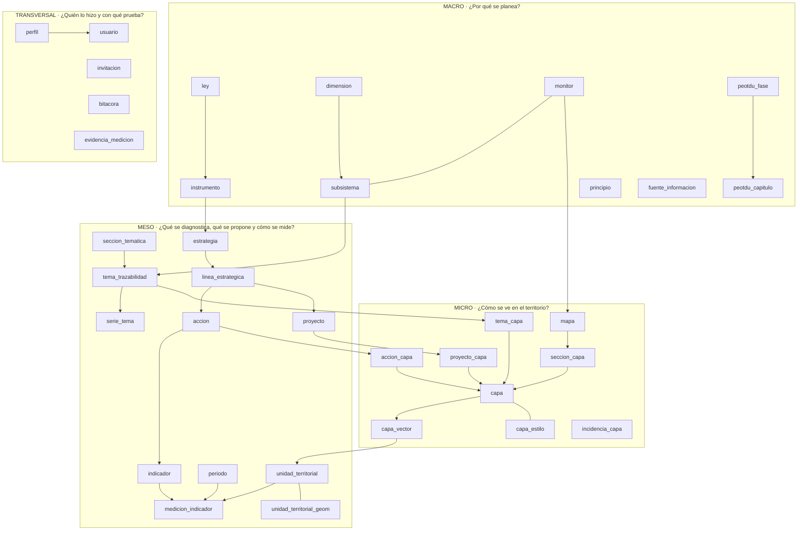
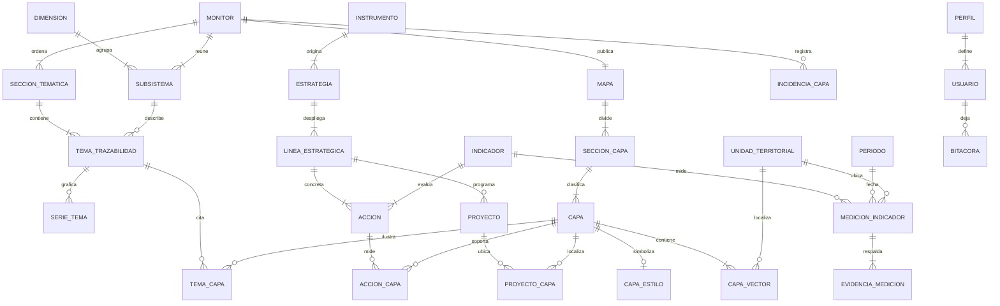

# SEOTDU — Arquitectura de datos

**Sistema:** Sistema Estatal de Ordenamiento Territorial y Desarrollo Urbano (Campeche) · Infraestructura pública digital
**Versión del documento:** 1.0 · octubre de 2026 · Etapa 4
**Modelo de referencia:** *Arquitectura de Datos SESIM*. Se conservan su estructura (Macro / Meso / Micro / Transversal), sus estados de medición y su regla de normalización de identificadores, adaptados al PEOTDU.
**Documentos hermanos:** `INTEGRACION-FRONTEND-BACKEND.md` (historial de cambios, matriz Frontend–Backend y flujo de estados de la interfaz) y `CLAUDE.md` (convenciones del código).

> **Cómo leer este documento.** Describe la base de datos destino (Supabase / PostgreSQL + PostGIS) y, en cada tabla, la columna **«Hoy»**: dónde vive ese dato mientras no existe el backend (Excel de `datos-fuente/` → script → JSON). Así sirve a la vez como especificación de la base y como mapa de la estructura actual del sistema. Las cifras se calcularon sobre los datos del repositorio en octubre de 2026.

---

## Índice

1. [Arquitectura lógica conceptual](#1-arquitectura-lógica-conceptual)
   - [1.1 MACRO: Gobernanza de datos (política pública)](#11-macro-gobernanza-de-datos-política-pública)
   - [1.2 MESO: Matriz de instrumentos y seguimiento del PEOTDU y territorio (transaccional)](#12-meso-matriz-de-instrumentos-y-seguimiento-del-peotdu-y-territorio-transaccional)
   - [1.3 MICRO: Operación geoespacial y vectores](#13-micro-operación-geoespacial-y-vectores)
   - [1.4 Seguridad y auditoría (transversal)](#14-seguridad-y-auditoría-transversal)
   - [1.5 Flujo transversal de usuarios institucionales y auditoría](#15-flujo-transversal-de-usuarios-institucionales-y-auditoría)
   - [1.6 Estados de una medición](#16-estados-de-una-medición)
2. [Diccionario de datos: composición de cada tabla](#2-diccionario-de-datos-composición-de-cada-tabla)
3. [Cardinalidad](#3-cardinalidad)
4. [Normalización de identificadores](#4-normalización-de-identificadores)
   - [4.1 Impacto en las llaves foráneas](#41-impacto-en-las-llaves-foráneas)
5. [Conexión entre tablas y su composición](#5-conexión-entre-tablas-y-su-composición)
6. [Adjetivos y verbos de las tablas](#6-adjetivos-y-verbos-de-las-tablas)
   - [6.1 Qué significa cada adjetivo](#61-qué-significa-cada-adjetivo)
   - [6.2 Lectura en lenguaje natural de las relaciones](#62-lectura-en-lenguaje-natural-de-las-relaciones)
7. [Funciones derivadas](#7-funciones-derivadas)
   - [7.1 Cruces con los datos actuales](#71-cruces-con-los-datos-actuales)
   - [7.2 Ejemplos de implementación](#72-ejemplos-de-implementación)
   - [7.3 Equivalencia de indicadores](#73-equivalencia-de-indicadores)

---

## 1. Arquitectura lógica conceptual

El sistema se organiza en tres niveles (Macro, Meso y Micro) y un módulo transversal de seguridad y auditoría. Es la misma lectura en cascada del modelo SESIM: de **por qué** se planea a **qué, cuándo y dónde** se mide y, al final, a **cómo se ve en el territorio**, con una huella de **quién hizo qué** en cada paso.

En el SEOTDU, ese recorrido sigue al paradigma teórico-metodológico del PEOTDU. Los **7 subsistemas** se agrupan en **3 dimensiones** y se leen en **5 monitores**. Cada monitor tiene dos vistas:

- **Desempeño territorial (insumos):** el diagnóstico de 2024, descrito por la trazabilidad modular.
- **Estrategia territorial (salidas):** estrategias, líneas, acciones, indicadores y proyectos.



*Tabla 1. Descripción de los bloques*

| Bloque | Pregunta | Tablas | Función |
|---|---|---|---|
| **MACRO** · Gobernanza de datos | ¿Por qué se planea y bajo qué marco? | `ley`, `instrumento`, `peotdu_fase`, `peotdu_capitulo`, `dimension`, `subsistema`, `monitor`, `principio`, `fuente_informacion` | Ordenamiento normativo y conceptual. Reglas estables: si cambia una ley o se publica un programa nuevo, solo este bloque se adapta. |
| **MESO** · Matriz de instrumentos y seguimiento | ¿Qué se diagnostica, qué se propone, cuándo y dónde se mide? | `seccion_tematica`, `tema_trazabilidad`, `serie_tema`, `estrategia`, `linea_estrategica`, `accion`, `indicador`, `proyecto`, `periodo`, `unidad_territorial`, `unidad_territorial_geom`, `medicion_indicador` | Núcleo de seguimiento del PEOTDU. Une la narrativa del diagnóstico y la matriz de estrategias con el tiempo y la geografía oficial. Es lo que consultan los paneles y los tableros. |
| **MICRO** · Operación geoespacial | ¿Cómo se ve en el territorio? | `mapa`, `seccion_capa`, `capa`, `capa_estilo`, `capa_vector`, `tema_capa`, `accion_capa`, `proyecto_capa`, `incidencia_capa` | Granularidad física. Separa el catálogo ligero de capas de las geometrías masivas y registra lo que aún no se puede desplegar. |
| **TRANSVERSAL** · Seguridad y auditoría | ¿Quién lo hizo y con qué prueba? | `perfil`, `usuario`, `invitacion`, `bitacora`, `evidencia_medicion` | Atraviesa los tres niveles: acceso por perfil, flujo de aprobación e historial inmutable. |

### 1.1 MACRO: Gobernanza de datos (política pública)

Define por qué existe cada dato y bajo qué marco de competencia. Guarda reglas estratégicas estables.

- **Ley y orden de gobierno:** CPEUM, Ley de Planeación, LGAHOTDU, LGEEPA y LGMSV, con el orden Federal / Estatal / Municipal de la pirámide de planeación. *Hoy:* `src/data/sistemaPlaneacion.ts`.
- **Instrumento de planeación:** el catálogo rector de los 35 programas vigentes o caducos: el PEOTDU y 34 instrumentos municipales y de centro de población (PDU, PMDU, POEL, POEPL), con su ficha técnica y sus enlaces de publicación. *Hoy:* `src/data/instrumentosData.ts` + `public/datos/publicaciones-instrumentos.json` (desde *Ficha-tecnica.xlsx*).
- **Estructura del PEOTDU:** 5 fases y 10 capítulos con su página en el PDF oficial. *Hoy:* `src/data/peotduEstructura.ts`.
- **Paradigma:** 3 dimensiones (Estructura, Desarrollo, Gobernanza territorial), 7 subsistemas y 5 monitores, en un orden único: Ambiental → Social → Infraestructura → Económico → Gobernanza (MOT). *Hoy:* `src/data/paradigmaPeotdu.ts` (`DIMENSIONES`, `SUBSISTEMAS`, `MONITORES_INSUMOS`, `ORDEN_MONITORES`).
- **Principio rector:** los 5 principios de la matriz de indicadores (Ciudad compacta, densa y mixta; Equidad e inclusión; Ciudades sustentables y resilientes; Gestión integral de riesgos y desastres; Inclusión urbana).
- **Fuente de información:** entidad que respalda cada dato (INEGI, CONABIO, CONANP, CENAPRED, SEMABICCE, OPMATPG…). Hoy va en el nombre del archivo de la capa (`C04_ANP_CONANP_2025`) y en columnas de texto libre.

### 1.2 MESO: Matriz de instrumentos y seguimiento del PEOTDU y territorio (transaccional)

Es el núcleo de seguimiento. Tiene dos caras, una por cada vista del geovisor.

- **Desempeño (insumos):** la **trazabilidad modular** describe cada tema del diagnóstico: descripción, variables, narrativa, analítica y series graficables. Va ordenada como *monitor → sección temática → tema*. *Hoy:* `public/datos/trazabilidad-temas.json` (61 temas: 50 de diagnóstico y 11 de políticas del MOT; 18 series) desde *Trazabilidad modular-SEOTDU.docx*.
- **Estrategia (salidas):** la matriz *estrategia → línea → acción → indicador* del PEOTDU (4 estrategias, 9 líneas, 41 acciones, 7 indicadores distintos) y la cartera de 32 proyectos de inversión. *Hoy:* `public/datos/estrategia-indicadores.json` y `proyectos-seguimiento.json` (desde *Estrategia-indicadores.xlsx* y *Proyecto-seguimiento.xlsx*).
- **Periodo y unidad territorial:** responden «¿cuándo?» y «¿dónde?». Las unidades son los 13 municipios y sus localidades (CVEGEO de INEGI); la geometría se guarda aparte. *Hoy:* `src/data/campecheData.ts`, `localidadesUrbanas.ts`, `Lim_Mun_Base.json`.
- **Medición de indicador:** la tabla de hechos. Todavía no hay mediciones: los 41 renglones tienen la línea base «Por definir». Es la tabla que encenderá el semáforo.

### 1.3 MICRO: Operación geoespacial y vectores

Representa la granularidad física. Como en SESIM, separa el catálogo de capas (ligero, de carga instantánea) de las geometrías (masivas).

- **Mapa y sección:** cada monitor del geovisor es un *mapa* con sus secciones temáticas; el Mapa Base es un mapa más, sin vista. *Hoy:* `public/layers/catalogo.json` (6 mapas, 112 capas).
- **Capa:** el catálogo alfanumérico. Su `categoria` (*Diagnostico*, *Estrategia* o *Mapa_Base*) decide la vista donde se lista.
- **Estilo:** la simbología exportada de QGIS, que pinta el mapa y genera la leyenda. *Hoy:* `public/estilos/**`.
- **Capa vector:** los elementos uno por uno. Son 53,125 en las 109 capas con archivo, en GeoJSON CRS84; las 3 restantes del catálogo no tienen archivo. *Hoy:* `public/layers/GeoJSON/**`.
- **Puentes:** `tema_capa` (tema ↔ capa: la *trazabilidad*), `accion_capa` (acción ↔ capa: el *indicador*), `proyecto_capa` (proyecto ↔ capa: la *ubicación del proyecto*).
- **Incidencia de capa:** capas citadas en el PEOTDU que todavía no se pueden desplegar (archivo inexistente, tabla vacía, capa no identificada). Son 69. *Hoy:* `src/data/incidencias-cartografia.json`, desde *Incidencias EN CARTOGRAFIA - SEOTDU.xlsx*.

### 1.4 Seguridad y auditoría (transversal)

- **Perfil y usuario:** control de acceso por rol, que separa a quien captura de quien valida y publica. La interfaz ya tiene los tres tableros (`src/components/perfiles/capturista`, `administradora`, `auditora`) y la ruta protegida `/admin-visor`.
- **Invitación:** token de un solo uso con el que el Administrador Titular da de alta a una persona con un perfil.
- **Bitácora:** registro automático, por disparadores, de cada cambio: tabla, registro, estado previo y nuevo, autor e IP.
- **Evidencia:** documento de respaldo (PDF o URL) anclado a una medición o a una capa, con huella SHA-256 para detectar alteraciones.

### 1.5 Flujo transversal de usuarios institucionales y auditoría

1. **Preparación (Macro).** El Administrador mantiene los catálogos: instrumentos, subsistemas, monitores, principios y fuentes. Ningún tema, acción ni capa se registra sin monitor y sin instrumento de origen.
2. **Captura (Meso / Micro).** El Capturista de una dependencia o municipio puede:
   - registrar una medición (indicador × periodo × unidad territorial);
   - subir una capa o su actualización;
   - capturar el avance de un proyecto.

   El registro nace en estado **borrador**. El tablero de captura ya muestra las bandejas «En borradores» y «Aprobados».
3. **Evidencia.** El Capturista adjunta el documento de respaldo y el sistema calcula su SHA-256.
4. **Envío y dictamen.** Al enviar, el registro pasa a **revision**. El Administrador dictamina en `panel-dictamen.tsx`:
   - **aprobar:** el registro pasa a **vigente_admin**;
   - **rechazar:** el registro pasa a **rechazado**, con comentario obligatorio.
5. **Publicación.** El registro validado pasa a **vigente_publico**. Solo entonces lo leen la página de inicio, el geovisor, el catálogo y el acceso vía MCP.
6. **Auditoría.** Cada cambio queda en `bitacora`. El Auditor, en modo de solo lectura, consulta el historial, verifica las huellas y registra hallazgos.

*Tabla 2. Perfiles institucionales y su alcance*

| Perfil | Qué hace | Escribe en | Lee |
|---|---|---|---|
| Capturista | Captura mediciones, capas y avances; sube evidencia | `medicion_indicador`, `capa` (borrador), `evidencia_medicion`, avance de `proyecto` | Catálogos y sus registros |
| Administrador | Mantiene catálogos; dictamina | Catálogos Macro, `tema_trazabilidad`, `accion`, `capa`, estados | Todo |
| Administrador Titular | Lo anterior y, en exclusiva, invita y da de baja | Lo anterior + `invitacion`, baja en `usuario` | Todo |
| Auditor | Observa sin modificar; registra hallazgos | Solo hallazgos | Todo, incluida `bitacora` |
| Sistema (disparadores) | Registra cada cambio | `bitacora` (solo inserción) | — |

### 1.6 Estados de una medición

Se adoptan los cinco estados del modelo SESIM para mediciones, capas, temas y proyectos. Así todo el contenido recorre el mismo flujo de aprobación.

*Tabla 3. Estados*

| Estado | Qué significa | Quién lo asigna | Quién lo ve |
|---|---|---|---|
| `borrador` | Guardado, no enviado | Capturista | Capturista |
| `revision` | Enviado a dictamen | Capturista (al enviar) | Capturista, administradores, auditor |
| `rechazado` | Devuelto con comentario obligatorio | Administrador | Capturista, administradores, auditor |
| `vigente_admin` | Aprobado; visible solo dentro del sistema | Administrador | Usuarios internos |
| `vigente_publico` | Publicado en el sitio | Administrador o Administrador Titular | Cualquier persona, sin iniciar sesión |

Transiciones válidas: `borrador → revision → (rechazado → revision)* → vigente_admin → vigente_publico`. Las vistas del esquema `api` que consume la interfaz pública filtran siempre `estado = 'vigente_publico'`.

---

## 2. Diccionario de datos: composición de cada tabla

Convenciones: **PK** llave primaria · **FK** llave foránea · **UQ** único · **N/S** nulo no/sí · `estado` usa el dominio de la Tabla 3 · `activo` es la baja lógica. Todas las tablas llevan `creado_en`, `actualizado_en` y `creado_por` (→ `usuario.id`); se omiten en las tablas siguientes.

### 2.1 ley

| Campo | Tipo | Llave | Nulo | Descripción |
|---|---|---|---|---|
| id | varchar(12) | PK | N | Siglas: `CPEUM`, `LP`, `LGAHOTDU`, `LGEEPA`, `LGMSV` |
| nombre | text | | N | Nombre oficial |
| orden_gobierno | text | CHECK | N | federal \| estatal \| municipal |
| url | text | | S | Publicación oficial |

*Hoy:* `LEYES` en `sistemaPlaneacion.ts`.

### 2.2 instrumento

| Campo | Tipo | Llave | Nulo | Descripción |
|---|---|---|---|---|
| id | varchar(24) | PK | N | Clave `TIPO-MUN-EDO-AÑO`: `PEOTDU-CAM-2023`, `PMDU-CAM-CAM-2020`, `POEL-HOP-CAM-2018` |
| nombre | text | | N | Nombre oficial |
| tipo | text | CHECK | N | PEOTDU \| PDU \| PMDU \| POEL \| POEPL |
| escala | text | CHECK | N | Estatal \| Municipal \| Centro de Población |
| id_unidad | varchar(9) | FK | S | → `unidad_territorial.id` (municipio). Vacío en el PEOTDU |
| ambito | text | | S | Política de gestión territorial, ecológica… |
| tipo_zonificacion | text | | S | Primaria, secundaria, UGA… |
| anio_publicacion | integer | | N | Año del decreto |
| version | text | CHECK | N | vigente \| caduco |
| vigencia | text | | S | «25 años» |
| dependencia | text | | N | AYUNTAMIENTO \| ESTADO |
| id_ley | varchar(12) | FK | S | → `ley.id`: fundamento del instrumento |
| link_publicacion | text | | S | Periódico Oficial |
| nota_publicacion | text | | S | Motivo cuando no hay enlace |
| link_repositorio | text | | S | Carpeta del repositorio institucional |
| link_pdf | text | | S | PDF servido por la plataforma |
| estado | text | CHECK | N | Tabla 3 |

*Hoy:* 35 registros: 1 PEOTDU, 12 PDU, 11 PMDU, 6 POEL y 4 POEPL de la ficha técnica, más PDU-HEC-CAM-2006, que no está en el catálogo. Hay 32 vigentes y 2 caducos.

### 2.3 peotdu_fase y peotdu_capitulo

| Campo | Tipo | Llave | Nulo | Descripción |
|---|---|---|---|---|
| fase.numero | smallint | PK | N | 1 a 5: Fundamentación, Diagnóstico integral, Prospectiva, Estrategia de implementación, Seguimiento y evaluación |
| fase.nombre | text | | N | |
| capitulo.numero | smallint | PK | N | 1 a 10 |
| capitulo.romano | text | | N | I … X |
| capitulo.titulo / corto | text | | N | Nombre completo y nombre para el índice |
| capitulo.fase | smallint | FK | N | → `peotdu_fase.numero` |
| capitulo.pagina | integer | | N | Página de inicio en el PDF oficial |
| capitulo.id_monitor | varchar(16) | FK | S | Monitor que lo desarrolla en el geovisor |

### 2.4 dimension, subsistema y monitor

| Tabla.campo | Tipo | Llave | Nulo | Descripción |
|---|---|---|---|---|
| dimension.id | varchar(12) | PK | N | `estructura` \| `desarrollo` \| `gobernanza` |
| dimension.nombre / color / explicacion | text | | N | Color: #2E8C8A, #2C5D86, #D2873A |
| subsistema.id | varchar(20) | PK | N | `fisico-natural`, `urbano-rural`, `movilidad`, `economico`, `patrimonio`, `sociodemografico`, `institucional` |
| subsistema.id_dimension | varchar(12) | FK | N | → `dimension.id` (agrupación **provisional**, por confirmar) |
| subsistema.id_monitor | varchar(16) | FK | N | → `monitor.id`, el monitor que lo agrupa |
| subsistema.numero_fachada | smallint | UQ | N | 1 a 7: fachada del larguillo de insumos |
| subsistema.descripcion | text | | N | |
| monitor.id | varchar(16) | PK | N | `ambiental`, `social`, `infraestructura`, `aptitud`, `normatividad` |
| monitor.nombre | text | | N | «Monitor Ambiental» … «Monitor de Gobernanza (MOT)» |
| monitor.orden | smallint | UQ | N | 1 a 5: orden único de los larguillos y del geovisor |
| monitor.color / tinta | text | | N | #77923B, #006FC0, #C00000, #FFC000, #1C334E |

*Agrupación vigente:*
- Ambiental = Físico natural
- Social = Sociodemográfico, Patrimonio
- Infraestructura = Urbano-rural, Movilidad
- Económico = Económico
- Gobernanza (MOT) = Institucionalidad y gobernanza

### 2.5 principio y fuente_informacion

| Campo | Tipo | Llave | Nulo | Descripción |
|---|---|---|---|---|
| principio.id | smallint | PK | N | |
| principio.nombre | text | UQ | N | 5 principios de la matriz de indicadores |
| fuente.id | varchar(16) | PK | N | `INEGI`, `CONABIO`, `CONANP`, `CENAPRED`, `SEMABICCE`, `OPMATPG`… |
| fuente.nombre / url | text | | N/S | Entidad acreditada |

### 2.6 seccion_tematica y tema_trazabilidad

| Campo | Tipo | Llave | Nulo | Descripción |
|---|---|---|---|---|
| seccion.id | varchar(40) | PK | N | slug `monitor-seccion` |
| seccion.id_monitor | varchar(16) | FK | N | Monitor de la trazabilidad (Ambiental, Social, Infraestructura, Económico, MOT) |
| seccion.nombre | text | | N | «Medio físico», «Servicios ecosistémicos», «Gobernanza institucional»… (21 secciones) |
| tema.id | varchar(120) | PK | N | slug `monitor-seccion-titulo` |
| tema.id_seccion | varchar(40) | FK | N | → `seccion_tematica.id` |
| tema.id_subsistema | varchar(20) | FK | N | → `subsistema.id` |
| tema.vista | text | CHECK | N | `desempeno` (diagnóstico) \| `estrategia` (políticas del MOT) |
| tema.titulo / tema | text | | N | Título y subtema |
| tema.descripcion | text | | S | «En este tema la variable corresponde a…» |
| tema.variables | text | | S | Variables analizadas |
| tema.capas_texto | text | | S | Capas citadas tal como vienen en el Word |
| tema.narrativa | text | | S | Pestaña **Narrativa** |
| tema.analitica | text | | S | Pestaña **Analítica**; viñetas «Título: texto» = tarjetas de cifras |
| tema.estado | text | CHECK | N | Tabla 3 |

*Hoy:* 61 temas (50 `desempeno` + 11 `estrategia`), generados con `scripts/extraer-trazabilidad.py`.

### 2.7 serie_tema

| Campo | Tipo | Llave | Nulo | Descripción |
|---|---|---|---|---|
| id | serial | PK | N | |
| id_tema | varchar(120) | FK | N | → `tema_trazabilidad.id` |
| titulo | text | | N | «Dos provincias fisiográficas en Campeche» |
| unidad | text | | S | %, km², hab… |
| tipo | text | CHECK | N | categoria \| anio: barras horizontales o columnas |
| datos | jsonb | | N | `[{ "etiqueta": "Península de Yucatán", "valor": 78 }, …]` |

*Hoy:* 18 series dentro del JSON de temas. Se sustituirán por `v_serie_indicador` cuando haya mediciones.

### 2.8 estrategia, linea_estrategica y accion

| Campo | Tipo | Llave | Nulo | Descripción |
|---|---|---|---|---|
| estrategia.id | varchar(6) | PK | N | Clave: `STA` (E1 Selva, tierra y agua), `CMTB` (E2 Campo, mar y turismo biocultural), `CHB` (E3 Comunidades, hogar y bienestar), `ITDUI` (E4 Integración territorial, desarrollo urbano e industria) |
| estrategia.numero | smallint | UQ | N | 1 a 4 |
| estrategia.nombre | text | | N | |
| estrategia.id_instrumento | varchar(24) | FK | N | → `instrumento.id` (`PEOTDU-CAM-2023`) |
| linea.id | varchar(6) | PK | N | `1.1` … `4.2` (9 líneas con indicador) |
| linea.id_estrategia | varchar(6) | FK | N | |
| linea.nombre | text | | N | «Protección y recualificación de la biodiversidad…» |
| accion.id | varchar(10) | PK | N | `1.1.14`, `4.2.3`… (41 acciones) |
| accion.id_linea | varchar(6) | FK | N | |
| accion.descripcion | text | | N | |
| accion.id_principio | smallint | FK | N | → `principio.id` |
| accion.id_indicador | varchar(8) | FK | N | → `indicador.id` |
| accion.justificacion | text | | S | Justificación urbana / ambiental |
| accion.responsable | text | | S | Dependencias responsables |

### 2.9 indicador

| Campo | Tipo | Llave | Nulo | Descripción |
|---|---|---|---|---|
| id | varchar(8) | PK | N | `IND-01` … `IND-07` (ver §7.3) |
| nombre | text | | N | |
| definicion | text | | N | Qué mide |
| metodo_calculo | text | | N | Fórmula |
| dimension | text | CHECK | N | Eficiencia \| Calidad \| Eficacia |
| unidad_medida | text | | N | Número de proyectos, Porcentaje… |
| unidad_analisis | text | | N | Estatal y municipal |
| frecuencia | text | | N | 3, 4 o 5 años |
| linea_base | numeric | | S | Hoy «Por definir» en todos |
| linea_aprobatoria | numeric | | S | |
| meta | text | | N | «Incrementar respecto a la línea base» |
| sentido | text | CHECK | N | ascendente \| descendente |
| semaforizacion | jsonb | | N | `{"verde":">= meta","amarillo":"75-99 %","rojo":"< 75 %"}` |
| id_fuente | varchar(16) | FK | S | |

### 2.10 proyecto

| Campo | Tipo | Llave | Nulo | Descripción |
|---|---|---|---|---|
| id | varchar(10) | PK | N | `STA-001`, `CMTB-007`: clave de estrategia + consecutivo |
| id_linea | varchar(6) | FK | N | → `linea_estrategica.id` |
| id_monitor | varchar(16) | FK | N | Monitor donde se publica |
| nombre | text | | N | |
| ubicacion | text | | S | «Xpujil, Calakmul» |
| monto | numeric(16,2) | | S | MXN |
| inversion_publica / privada | boolean | | N | |
| plazo | text | CHECK | N | corto \| mediano \| largo |
| prioridad | text | CHECK | S | alta \| media \| baja |
| responsable / coordinacion | text | | S | |
| poblacion_beneficiada | text | | S | |
| financiamiento | text | | S | |
| avance | numeric(5,2) | | S | % de avance físico (futuro) |
| estado | text | CHECK | N | Tabla 3 |

*Hoy:* 32 proyectos: 11 Económico, 9 Infraestructura, 7 Ambiental y 5 Social. De ellos, 28 tienen capa ligada (30 capas distintas).

### 2.11 periodo

| Campo | Tipo | Llave | Nulo | Descripción |
|---|---|---|---|---|
| id | integer | PK | N | |
| anio | integer | | N | |
| etiqueta | text | UQ | N | «2024», «2026-T1» |
| tipo_periodo | text | CHECK | S | anual \| trienal \| cuatrienal \| quinquenal |
| fecha_inicio / fecha_fin | date | | S | |

### 2.12 unidad_territorial y unidad_territorial_geom

| Campo | Tipo | Llave | Nulo | Descripción |
|---|---|---|---|---|
| id | varchar(9) | PK | N | CVEGEO INEGI: 5 dígitos (municipio, 04001–04013) o 9 (localidad) |
| id_padre | varchar(9) | FK | S | Municipio de la localidad |
| nivel | text | CHECK | N | estado \| municipio \| localidad |
| nombre | text | | N | |
| tipo | text | CHECK | S | urbana (≥ 2,500 hab.) \| rural |
| pob_tot | integer | | S | Censo 2020 |
| anio_creacion | integer | | S | Decreto de creación (estado: 1863) |
| pib_participacion | numeric | | S | % de la economía estatal |
| geom.id_unidad | varchar(9) | PK, FK | N | 1 a 0..1 |
| geom.geom | geometry(MultiPolygon, 4326) | | N | Límite oficial |

*Hoy:* `campecheData.ts`, `indicadoresTerritoriales.ts`, `localidadesUrbanas.ts` y `Lim_Mun_Base.json`.

### 2.13 medicion_indicador

| Campo | Tipo | Llave | Nulo | Descripción |
|---|---|---|---|---|
| id | uuid | PK | N | |
| id_indicador | varchar(8) | FK | N | |
| id_accion | varchar(10) | FK | S | Acción que se evalúa (el mismo indicador sirve a varias) |
| id_periodo | integer | FK | N | |
| id_unidad | varchar(9) | FK | N | |
| valor | numeric | | S | |
| valor_texto | text | | S | Cualitativo |
| estado | text | CHECK | N | Tabla 3 |
| usuario_captura | uuid | FK | N | |
| usuario_validacion | uuid | FK | S | Obligatorio a partir de `vigente_admin` |
| comentario_rechazo | text | | S | Obligatorio en `rechazado` |
| UQ | | | | (`id_indicador`, `id_accion`, `id_periodo`, `id_unidad`) |

### 2.14 mapa y seccion_capa

| Campo | Tipo | Llave | Nulo | Descripción |
|---|---|---|---|---|
| mapa.id | varchar(16) | PK | N | `mapa_base` + los 5 monitores |
| mapa.id_monitor | varchar(16) | FK | S | Vacío en Mapa Base |
| mapa.carpeta / titulo | text | | N | `01_Ambiental` / «Ambiental» |
| seccion.id | varchar(40) | PK | N | |
| seccion.id_mapa | varchar(16) | FK | N | |
| seccion.titulo | text | | N | «Medio físico natural», «Selva, tierra y agua»… |
| seccion.eje | text | | S | `desempeno_territorial` \| `estrategia_territorial` |

### 2.15 capa

| Campo | Tipo | Llave | Nulo | Descripción |
|---|---|---|---|---|
| id | varchar(80) | PK | N | Nombre de archivo en minúsculas: `c04_erosionsuelo_inegi_2014` |
| clave_norm | varchar(80) | UQ | N | `norm(id)` (§4); une la capa con el Word, los Excel y QGIS |
| nombre_original | text | | S | Nombre de QGIS: `C04_ErosionSuelo_INEGI_2014` |
| titulo | text | | N | Nombre legible (`nombreCapaLegible`) |
| id_seccion | varchar(40) | FK | N | → `seccion_capa.id` |
| categoria | text | CHECK | N | Diagnostico \| Estrategia \| Mapa_Base |
| vista | text | GENERATED | S | `desempeno` si Diagnóstico, `estrategia` si Estrategia |
| tipo_geometria | text | CHECK | N | Point \| LineString \| Polygon (y Multi) |
| srid_origen | integer | | N | 6372, 32615, 4326… |
| id_fuente | varchar(16) | FK | S | |
| id_instrumento | varchar(24) | FK | S | `PEOTDU-CAM-2023` en Diagnóstico y Estrategia |
| anio | integer | | S | Año del dato |
| archivo / ruta | text | | N | Ruta del GeoJSON |
| fija | boolean | | N | Se dibuja con su módulo sin control propio (límites, búfer) |
| excluida | boolean | | N | No se muestra (estilo no traducible o sin atributos) |
| encendida_por_omision | boolean | | N | `defaultLayers` |
| n_elementos | integer | | N | Elementos en `capa_vector` |
| metadatos_extra | jsonb | | S | ISO 19115: linaje, escala nominal, denominador de escala, periodicidad… |
| estado | text | CHECK | N | Tabla 3 |

### 2.16 capa_estilo

| Campo | Tipo | Llave | Nulo | Descripción |
|---|---|---|---|---|
| id_capa | varchar(80) | PK, FK | N | |
| simbologia | jsonb | | N | Renderer de QGIS (único, categorizado, graduado, reglas) |
| etiquetas | jsonb | | S | Rótulos por zoom |
| origen | text | | N | Archivo de volcado de QGIS |

### 2.17 capa_vector

| Campo | Tipo | Llave | Nulo | Descripción |
|---|---|---|---|---|
| id | uuid | PK | N | |
| id_capa | varchar(80) | FK | N | |
| id_unidad | varchar(9) | FK | S | Unidad territorial donde cae (localidad o municipio) |
| id_origen | text | | N | Identificador en el archivo fuente |
| nombre / clasif | text | | S | Atributos comunes de lectura y simbología |
| propiedades | jsonb | | N | Atributos temáticos (SCINCE, DENUE…) |
| geom | geometry(Geometry, 4326) | | N | GIST |

*Hoy:* 53,125 elementos en las 109 capas con archivo. Por mapa: Mapa Base 25,220; Infraestructura 15,200; Económico 8,318; Ambiental 3,761; Social 586; MOT 40.

### 2.18 Puentes tema_capa, accion_capa y proyecto_capa

| Tabla | Campos | Llave | Lectura |
|---|---|---|---|
| tema_capa | id_tema, clave_capa, orden | PK (id_tema, clave_capa) | El tema del diagnóstico **se ilustra con** la capa |
| accion_capa | id_accion, clave_capa | PK (id_accion, clave_capa) | La acción **se mide sobre** la capa con su indicador |
| proyecto_capa | id_proyecto, clave_capa | PK (id_proyecto, clave_capa) | El proyecto **se ubica en** la capa |

Los puentes usan `clave_capa = capa.clave_norm` y no `capa.id`. Así una capa citada que aún no existe se registra igual y se resuelve sola cuando la capa se publica (§4.1).

### 2.19 incidencia_capa

| Campo | Tipo | Llave | Nulo | Descripción |
|---|---|---|---|---|
| id | serial | PK | N | |
| clave_capa | varchar(80) | | S | `norm(archivo)`; vacío si la capa no se identificó |
| id_monitor | varchar(16) | FK | N | |
| id_subsistema | varchar(20) | FK | S | |
| tematica | text | | S | Tema de la trazabilidad al que pertenece |
| nombre | text | | N | |
| archivo | text | | S | |
| vista | text | CHECK | N | `desempeno` \| `estrategia` (los «Proyecto: …» de la EEMSV) |
| estatus | text | CHECK | N | archivos_inexistentes \| tabla_vacia \| no_identificada \| pendiente \| resuelta |
| incidencia / observaciones | text | | S | |
| resuelta_en | date | | S | Se llena al publicar la capa |

*Hoy:* 69 incidencias: 63 por archivo inexistente, 2 capas no identificadas, 1 tabla vacía (Karst) y 3 pendientes.

### 2.20 perfil, usuario, invitacion, bitacora y evidencia_medicion

| Tabla.campo | Tipo | Llave | Nulo | Descripción |
|---|---|---|---|---|
| perfil.id | smallint | PK | N | capturista \| administrador \| administrador_titular \| auditor |
| usuario.id | uuid | PK | N | `auth.users` de Supabase |
| usuario.id_perfil | smallint | FK | N | |
| usuario.dependencia / id_unidad | text / varchar(9) | FK | S | Ámbito de captura |
| usuario.activo | boolean | | N | Baja lógica |
| invitacion.token_hash | text | UQ | N | Solo el hash del token |
| invitacion.id_perfil / expira / usada_en / id_usuario_creado | | FK | | |
| bitacora.id | bigserial | PK | N | Solo inserción |
| bitacora.tabla / id_registro / accion / antes / despues / id_usuario / ip / en | | | | `antes` y `despues` en jsonb |
| evidencia.id | uuid | PK | N | |
| evidencia.tabla / id_registro | text | | N | Medición, capa o proyecto |
| evidencia.url / hash_archivo | text / char(64) | | N | SHA-256 |

---

## 3. Cardinalidad

*Tabla 4. Relaciones*

| Relación | Cardinalidad | Lectura |
|---|---|---|
| ley → instrumento | 1 : N | Una ley fundamenta muchos instrumentos |
| unidad_territorial (municipio) → instrumento | 1 : 0..N | Un municipio tiene de 0 a varios PDU / PMDU / POEL |
| peotdu_fase → peotdu_capitulo | 1 : N | 5 fases, 10 capítulos |
| dimension → subsistema | 1 : N | 3 → 7 |
| monitor → subsistema | 1 : 1..N | 5 monitores agrupan los 7 subsistemas |
| monitor → mapa | 1 : 1 | Cada monitor es un mapa del geovisor (el Mapa Base no tiene monitor) |
| monitor → seccion_tematica | 1 : N | 21 secciones temáticas |
| seccion_tematica → tema_trazabilidad | 1 : N | 61 temas |
| subsistema → tema_trazabilidad | 1 : N | Físico natural tiene 15 temas; Movilidad, 3 |
| tema_trazabilidad → serie_tema | 1 : 0..N | 18 series en 12 temas |
| tema_trazabilidad ↔ capa | N : M (`tema_capa`) | 119 capas citadas; un tema cita hasta 13 capas |
| instrumento → estrategia | 1 : N | El PEOTDU → 4 estrategias |
| estrategia → linea_estrategica → accion | 1 : N : N | 4 → 9 → 41 |
| indicador → accion | 1 : N | 7 indicadores sirven a 41 acciones (§7.3) |
| accion ↔ capa | N : M (`accion_capa`) | Hoy 1 : 1 (41 capas) |
| linea_estrategica → proyecto | 1 : N | 32 proyectos |
| proyecto ↔ capa | N : M (`proyecto_capa`) | 28 proyectos con capa, 30 capas |
| mapa → seccion_capa → capa | 1 : N : N | 6 mapas, 112 capas |
| capa → capa_estilo | 1 : 0..1 | |
| capa → capa_vector | 1 : N | 53,125 elementos |
| unidad_territorial → capa_vector | 1 : 0..N | Cada elemento cae en una unidad |
| unidad_territorial → unidad_territorial_geom | 1 : 0..1 | |
| indicador × periodo × unidad → medicion_indicador | 1 : N cada una | Tabla de hechos |
| medicion_indicador → evidencia_medicion | 1 : 1..N | Sin evidencia no se publica |
| monitor → incidencia_capa | 1 : N | 69 incidencias |
| perfil → usuario | 1 : N | |
| usuario → bitacora | 1 : N | |



---

## 4. Normalización de identificadores

La misma capa llega con cuatro nombres distintos:

| Origen | Ejemplo |
|---|---|
| Volcado de QGIS (estilos) | `C04_ANP_Río_Candelaria_OPMATPG_2023` |
| Archivo GeoJSON (catálogo) | `c04_anp_rio_candelaria_opmatpg_2023` |
| Word de trazabilidad | `C04_ANPRioCandelaria_OPMATPG_2023` (sin guiones, en CamelCase) |
| Excel de estrategia / proyectos / incidencias | `C04_ANP_Río_Candelaria_OPMATPG_2023.shp` o el nombre legible |

**Regla única (`norm`).** Se descompone a NFKD, se quitan los acentos, se pasa a minúsculas y se elimina todo lo que no sea `[a-z0-9]`:

```
C04_ANP_Río_Candelaria_OPMATPG_2023  →  c04anpriocandelariaopmatpg2023
```

La regla está implementada en tres sitios, con el mismo resultado:

- `src/lib/cartografia.ts → norm()`
- la copia local en `module-layer-selector.tsx`
- `norm()` en `scripts/*.py`

En la base será una función inmutable, `api.norm(text)`, y una columna `capa.clave_norm` con índice único.

*Tabla 5. Convención de identificadores por tabla*

| Tabla | Formato | Ejemplo |
|---|---|---|
| instrumento | `TIPO-MUN-EDO-AÑO` | `PMDU-CHAM-CAM-2024` |
| estrategia | clave del PEOTDU | `STA`, `CMTB`, `CHB`, `ITDUI` |
| linea_estrategica / accion | numeración del PEOTDU | `1.3`, `1.1.14` |
| indicador | `IND-NN` | `IND-01` |
| proyecto | `CLAVE-NNN` | `STA-001` |
| subsistema / monitor / dimension | slug | `fisico-natural`, `aptitud`, `gobernanza` |
| seccion / tema | slug `monitor-seccion[-titulo]` | `ambiental-medio-fisico-provincias-fisiograficas` |
| capa | archivo en minúsculas + `clave_norm` | `c04_karst_cenapred_2023` / `c04karstcenapred2023` |
| unidad_territorial | CVEGEO INEGI | `04002`, `040020001` |

### 4.1 Impacto en las llaves foráneas

- **Puentes por `clave_norm`.** `tema_capa`, `accion_capa`, `proyecto_capa` e `incidencia_capa` referencian la clave normalizada, no el id. Así un tema puede citar una capa todavía no publicada, una incidencia se cierra sola al publicarla (`v_incidencias_abiertas`) y no se rompe ningún vínculo al renombrar el archivo.
- **Validación.** Cada puente tiene un disparador que avisa (no bloquea) cuando la clave no existe en `capa`. Hoy 60 claves citadas en la trazabilidad no están en el catálogo; casi todas aparecen en la tabla de incidencias.
- **Legibilidad.** `capa.nombre_original` conserva la forma con mayúsculas, que da mejores nombres legibles que el archivo en minúsculas (`EROSIONSUELO` frente a `Erosión de suelo`).
- **Datos externos.** El monitor del Excel de incidencias («Económico», «MOT») se traduce al id del módulo (`aptitud`, `normatividad`) en `scripts/extraer-incidencias.py`; la base lo hará con un catálogo de alias de `monitor`.
- **Doble codificación.** Algunos nombres llegan como «Champotón». `repararCodificacion()` (`textoLegible.ts`) los corrige en la interfaz; en la carga a la base se corrigen una sola vez.

---

## 5. Conexión entre tablas y su composición

Tres recorridos explican casi todas las consultas de la interfaz:

**A. Larguillo de subsistemas → geovisor en Desempeño**

```
subsistema ─< tema_trazabilidad (vista = desempeno) ─< tema_capa >─ capa (categoria = Diagnostico)
   │                    │                                                │
   └─ monitor ── mapa   └─ serie_tema                                    └─< capa_vector
```

La fachada «Físico natural» abre 15 temas. Las capas que citan y que el geovisor publica en Diagnóstico son 8; «Encender sus 8 capas» las enciende con `/geovisor?modulo=ambiental&vista=desempeno&subsistema=fisico-natural&capas=…`.

**B. Panel de una capa de estrategia**

```
capa ─< accion_capa >─ accion >─ linea_estrategica >─ estrategia >─ instrumento
                         │
                         └─ indicador ─< medicion_indicador >─ periodo, unidad_territorial
capa ─< proyecto_capa >─ proyecto
```

**C. Caja de un monitor en el geovisor**

```
monitor ── mapa ─< seccion_capa ─< capa
                                    ├─ vista = desempeno  ∧  tema con narrativa y analítica  → se lista en Desempeño
                                    ├─ vista = estrategia                                    → se lista en Estrategia
                                    └─ incidencia_capa (abierta)                             → «Capas pendientes de publicar»
```

---

## 6. Adjetivos y verbos de las tablas

*Tabla 6. Clase de cada tabla*

| Tabla | Adjetivo | Verbo principal |
|---|---|---|
| ley, instrumento | Normativa | fundamenta, origina |
| peotdu_fase, peotdu_capitulo | Estructural | organiza |
| dimension, subsistema, monitor | Conceptual (catálogo rector) | agrupa, reúne |
| principio, fuente_informacion | Catálogo de referencia | orienta, respalda |
| seccion_tematica, tema_trazabilidad | Descriptiva (narrativa) | describe, cita |
| serie_tema | Derivada (provisional) | grafica |
| estrategia, linea_estrategica, accion | Programática | despliega, concreta |
| indicador | Maestra (ficha técnica) | evalúa |
| proyecto | Programática transaccional | programa, ubica |
| periodo, unidad_territorial | Dimensión | fecha, ubica |
| unidad_territorial_geom | Geometría de dimensión | delimita |
| medicion_indicador | Hechos | mide |
| mapa, seccion_capa | Catálogo de presentación | divide, clasifica |
| capa | Catálogo maestro geoespacial | ilustra, soporta |
| capa_estilo | Presentación | simboliza |
| capa_vector | Masiva | contiene, localiza |
| tema_capa, accion_capa, proyecto_capa | Puente | vincula |
| incidencia_capa | Control de calidad | registra, bloquea |
| perfil, usuario, invitacion | Seguridad | define, autoriza |
| bitacora | Auditoría (solo inserción) | deja huella |
| evidencia_medicion | Auditoría documental | respalda |

### 6.1 Qué significa cada adjetivo

- **Normativa:** existe por mandato legal y cambia solo con un decreto.
- **Conceptual:** traduce el paradigma del PEOTDU en categorías. Ordena la interfaz completa: larguillos, diagrama y cajas.
- **Descriptiva:** texto que explica el territorio. Se aprueba como un dato más (estados de la Tabla 3).
- **Programática:** lo que el PEOTDU propone hacer.
- **Maestra:** ficha única que muchos registros reutilizan.
- **Dimensión:** responde «¿cuándo?» o «¿dónde?» para cualquier hecho.
- **Hechos:** el valor medido; crece en el tiempo y nunca se sobrescribe, se versiona.
- **Masiva:** miles de filas con geometría; se consulta por teselas o por extensión, nunca completa.
- **Puente:** resuelve un muchos a muchos.
- **Control de calidad:** documenta por qué algo no se puede mostrar.
- **Auditoría:** se escribe una vez y no se modifica.

### 6.2 Lectura en lenguaje natural de las relaciones

- Una **ley** *fundamenta* muchos **instrumentos**, y el PEOTDU *origina* cuatro **estrategias**.
- Cada **estrategia** *se despliega* en **líneas**, y cada línea *se concreta* en **acciones**.
- Cada **acción** *es evaluada* por un **indicador** y *se mide sobre* una **capa**.
- Una **dimensión** *agrupa* **subsistemas**; un **monitor** *reúne* uno o más subsistemas y *publica* un **mapa** en el geovisor.
- Un **subsistema** *es descrito* por **temas** de la trazabilidad; cada tema *cita* **capas** y *puede graficarse* en **series**.
- Una **capa** *pertenece* a una **sección** de un **mapa**, *se simboliza* con un **estilo** y *contiene* **elementos** que *caen* en una **unidad territorial**.
- Un **proyecto** *se programa* en una **línea estratégica** y *se ubica* en una o más **capas**.
- Una **medición** *mide* un **indicador** en un **periodo** y una **unidad territorial**, y *se respalda* con **evidencia**.
- Una **incidencia** *registra* por qué una capa citada todavía no *se puede desplegar*.
- Cada cambio *deja huella* en la **bitácora** a nombre de un **usuario** con un **perfil**.

---

## 7. Funciones derivadas

Funciones y vistas del esquema `api`: las que consume la interfaz (por `src/lib/datosPrograma.ts` y `src/lib/cartografia.ts`), los tableros y el acceso vía MCP.

*Tabla 7. Catálogo de funciones y vistas*

| ID | Nombre y tipo | Cruce | Resultado | Para qué sirve | Ubicación en la interfaz |
|---|---|---|---|---|---|
| F01 | `fn_capas_por_vista(p_monitor, p_vista)` (función) | capa ⨝ seccion_capa ⨝ mapa; tema_capa; tema | Capas listables: en Desempeño, solo Diagnóstico con narrativa y analítica; en Estrategia, solo Estrategia | Contenido de cada caja | Geovisor · cajas de monitores (`visibleEnVista`) |
| F02 | `fn_completitud_capa(p_clave)` (función) | tema_capa ⨝ tema; accion_capa; proyecto_capa | `{narrativa, analitica, estrategia}` | Decide qué pestañas abre el panel y si se abre | Geovisor · `PanelCapa` (`getCompletitudCapas`) |
| F03 | `v_panel_desempeno` (vista) | tema ⨝ tema_capa ⨝ serie_tema | Narrativa, analítica y series por capa | Pestañas Narrativa / Analítica | Geovisor · panel; Inicio · larguillo de subsistemas |
| F04 | `fn_estrategia_de_capa(p_clave)` (función) | accion_capa ⨝ accion ⨝ linea ⨝ estrategia ⨝ indicador | Fila de estrategia e indicador | Pestaña Estrategia | Geovisor · panel |
| F05 | `v_seguimiento_proyecto` (vista) | proyecto ⨝ proyecto_capa ⨝ linea ⨝ estrategia | Ficha del proyecto con capas | Acordeón de proyectos y «Ver en el geovisor» | Inicio · larguillo de monitores |
| F06 | `v_larguillo_subsistemas` (vista) | subsistema ⨝ monitor ⨝ dimension; conteos de tema y capa | Fachada, cornisa, placa (temas · capas) | Gráfico de insumos | Inicio · larguillo de subsistemas |
| F07 | `v_serie_indicador` (vista) | medicion ⨝ periodo ⨝ unidad (solo `vigente_publico`) | Serie de tiempo por indicador y municipio | Sustituye a `serie_tema` | Panel · Analítica; tableros |
| F08 | `fn_semaforo(p_ind, p_unidad, p_periodo)` (función) | medicion ⨝ indicador | Sin línea base / mejora · estable · retrocede / verde · amarillo · rojo | Semaforización del PEOTDU | Panel · Estrategia; tablero |
| F09 | `fn_tasa_por_poblacion` (función) | medicion ⨝ unidad_territorial | valor ÷ pob_tot × base | Comparar municipios de distinto tamaño | Tableros |
| F10 | `v_capa_por_municipio` (vista) | capa_vector ⨝ unidad_territorial | Elementos, km y km² por capa y municipio | Diagnóstico por municipio | Geovisor · pestaña Información |
| F11 | `v_incidencias_abiertas` (vista) | incidencia_capa ⟕ capa (por `clave_norm`) | Incidencias sin capa publicada, por monitor y vista | «Capas pendientes de publicar» | Geovisor · cajas; Inicio · temas |
| F12 | `v_cobertura_instrumento` (vista) | instrumento ⨝ unidad_territorial | Instrumentos por municipio, tipo y vigencia; municipios sin PMDU | Catálogo y control de vigencias | Catálogo de instrumentos |
| F13 | `fn_transicion_estado(p_tabla, p_id, p_estado, p_comentario)` (función) | registro ⨝ usuario ⨝ perfil ⨝ evidencia → bitacora | Cambia el estado si el perfil lo permite y hay evidencia | Flujo captura → dictamen → publicación | Tableros de capturista y administrador |
| F14 | `fn_verificar_evidencia(p_id)` (función) | evidencia_medicion | TRUE si el SHA-256 coincide | Integridad documental | Tablero del auditor |
| F15 | `v_historial_registro` (vista) | bitacora ⨝ usuario ⨝ perfil | Línea de tiempo de cambios | Hallazgos de auditoría | Tablero del auditor |
| F16 | `v_equivalencia_indicador` (vista) | indicador ⨝ accion ⨝ capa | Acciones y capas por indicador | Detectar indicadores repetidos o inconsistentes (§7.3) | Tablero del administrador |

### 7.1 Cruces con los datos actuales

Aunque todavía no hay mediciones, los cruces entre catálogos ya producen información útil.

*Tabla 8. Capas publicadas por monitor y vista (catálogo del geovisor)*

| Monitor | Desempeño (Diagnóstico) | … con narrativa y analítica | Estrategia | Incidencias D / E |
|---|---|---|---|---|
| Ambiental | 10 | 8 | 14 | 34 / 0 |
| Social | 7 | 4 | 5 | 8 / 7 |
| Infraestructura | 27 | 7 | 13 | 11 / 7 |
| Económico | 7 | 5 | 9 | 2 / 0 |
| Gobernanza (MOT) | 0 | 0 | 1 + 40 en su árbol E1–E4 | 0 / 0 |
| Mapa Base | 19 (sin vista) | — | — | — |
| **Total** | **51** | **24** | **42** | **55 / 14** |

Solo 24 de las 51 capas de diagnóstico tienen tema con narrativa y analítica, y son las únicas que lista la vista Desempeño. Infraestructura concentra la brecha: 27 capas publicadas, 7 con trazabilidad.

*Tabla 9. Temas de diagnóstico por subsistema (larguillo de insumos)*

| Monitor | Subsistema | Temas | Capas en el geovisor |
|---|---|---|---|
| Ambiental | Físico natural | 15 | 8 |
| Social | Sociodemográfico | 9 | 1 |
| Social | Patrimonio cultural, natural y biocultural | 3 | 4 |
| Infraestructura | Urbano-rural | 10 | 3 |
| Infraestructura | Movilidad | 3 | 0 |
| Económico | Económico | 7 | 5 |
| Gobernanza (MOT) | Institucionalidad y gobernanza | 3 | 0 |

Los 3 temas de Institucionalidad vienen de la sección «Gobernanza» del monitor Social de la trazabilidad. En la presentación se agrupan bajo Gobernanza (MOT), y el dato conserva su `id_seccion` de origen. La sección «Gobernanza institucional» de Infraestructura (3 temas) hoy se clasifica como Urbano-rural; conviene reasignarla a Institucionalidad.

*Tabla 10. Matriz estratégica y cartera de proyectos*

| Estrategia | Acciones con indicador | Proyectos |
|---|---|---|
| E1 · Selva, tierra y agua (`STA`) | 13 | 7 |
| E2 · Campo, mar y turismo biocultural (`CMTB`) | 9 | 11 |
| E3 · Comunidades, hogar y bienestar (`CHB`) | 5 | 5 |
| E4 · Integración territorial, desarrollo urbano e industria (`ITDUI`) | 14 | 9 |
| **Total** | **41** | **32** |

Plazo de los proyectos: 16 cortos, 13 medianos y 3 largos. Prioridad: 23 alta, 7 media y 2 sin dato («X»).

*Tabla 11. Instrumentos de planeación*

| Tipo | Escala | Registros |
|---|---|---|
| Programa Estatal (PEOTDU) | Estatal | 1 |
| Programa Director Urbano (PDU) | Centro de Población | 12 |
| Programa Municipal de Desarrollo Urbano (PMDU) | Municipal | 11 |
| Programa de Ordenamiento Ecológico Local (POEL) | Municipal | 6 |
| Programa de Ordenamiento Ecológico Participativo Local | Municipal | 4 |

Los 34 instrumentos del catálogo cubren los 13 municipios (32 vigentes, 2 caducos). 23 tienen enlace a su publicación oficial.

*Tabla 12. Incidencias de cartografía por estatus*

| Estatus | Registros |
|---|---|
| Archivos inexistentes (solo XML o DBF en el repositorio) | 63 |
| Capas no identificadas | 2 |
| Tabla de atributos vacía (Karst, CENAPRED 2023) | 1 |
| Pendiente (sin estatus) | 3 |

Además, 13 renglones del Excel (capas de riesgo R04_* y el «Sistema de ciudades») no indican monitor y no se cargan. Hay que asignárselo.

### 7.2 Ejemplos de implementación

**F01 · Capas listables por vista** (la regla que hoy aplica `visibleEnVista` en el geovisor):

```sql
CREATE FUNCTION api.fn_capas_por_vista(p_monitor varchar, p_vista text)
RETURNS SETOF api.capa_publica LANGUAGE sql STABLE AS $$
  SELECT c.*
  FROM capa c
  JOIN seccion_capa s ON s.id = c.id_seccion
  JOIN mapa m         ON m.id = s.id_mapa
  WHERE m.id_monitor = p_monitor
    AND c.estado = 'vigente_publico' AND NOT c.excluida
    AND (
      (p_vista = 'estrategia' AND c.categoria = 'Estrategia')
      OR (p_vista = 'desempeno' AND c.categoria = 'Diagnostico' AND EXISTS (
            SELECT 1 FROM tema_capa tc
            JOIN tema_trazabilidad t ON t.id = tc.id_tema
            WHERE tc.clave_capa = c.clave_norm
              AND t.vista = 'desempeno' AND t.estado = 'vigente_publico'
              AND coalesce(t.narrativa, t.descripcion) <> ''
              AND (t.analitica <> '' OR EXISTS (SELECT 1 FROM serie_tema st WHERE st.id_tema = t.id))
      ))
    )
  ORDER BY c.titulo;
$$;
```

**F02 · Completitud del panel:**

```sql
CREATE FUNCTION api.fn_completitud_capa(p_clave varchar)
RETURNS jsonb LANGUAGE sql STABLE AS $$
  SELECT jsonb_build_object(
    'narrativa',  EXISTS (SELECT 1 FROM tema_capa tc JOIN tema_trazabilidad t ON t.id = tc.id_tema
                          WHERE tc.clave_capa = p_clave AND t.vista = 'desempeno'
                            AND coalesce(t.narrativa, t.descripcion) <> ''),
    'analitica',  EXISTS (SELECT 1 FROM tema_capa tc JOIN tema_trazabilidad t ON t.id = tc.id_tema
                          WHERE tc.clave_capa = p_clave AND t.vista = 'desempeno'
                            AND (t.analitica <> '' OR EXISTS (SELECT 1 FROM serie_tema s WHERE s.id_tema = t.id))),
    'estrategia', EXISTS (SELECT 1 FROM accion_capa WHERE clave_capa = p_clave)
               OR EXISTS (SELECT 1 FROM proyecto_capa WHERE clave_capa = p_clave)
  );
$$;
```

**F08 · Semáforo.** Mientras no haya línea base, devuelve «sin línea base». La primera medición publicada se guarda como línea base; desde ahí el semáforo compara cada valor según el `sentido` del indicador. Cuando exista meta numérica, se aplican los umbrales de `indicador.semaforizacion`: verde ≥ meta, amarillo 75–99 %, rojo < 75 %.

```sql
CREATE FUNCTION api.fn_semaforo(p_ind varchar, p_uni varchar, p_per int)
RETURNS text LANGUAGE sql STABLE AS $$
  WITH v AS (
    SELECT m.valor, i.linea_base, i.sentido,
           nullif(regexp_replace(i.meta, '[^0-9.]', '', 'g'), '')::numeric AS meta_num
    FROM medicion_indicador m JOIN indicador i ON i.id = m.id_indicador
    WHERE m.id_indicador = p_ind AND m.id_unidad = p_uni AND m.id_periodo = p_per
      AND m.estado = 'vigente_publico'
  )
  SELECT CASE
    WHEN valor IS NULL THEN 'sin dato'
    WHEN linea_base IS NULL THEN 'sin línea base'
    WHEN meta_num IS NULL THEN
      CASE WHEN (valor - linea_base) * (CASE sentido WHEN 'descendente' THEN -1 ELSE 1 END) > 0 THEN 'mejora'
           WHEN valor = linea_base THEN 'estable' ELSE 'retrocede' END
    WHEN valor / meta_num >= 1    THEN 'verde'
    WHEN valor / meta_num >= 0.75 THEN 'amarillo'
    ELSE 'rojo'
  END FROM v;
$$;
```

**F11 · Incidencias abiertas** (se cierran solas cuando la capa se publica):

```sql
CREATE VIEW api.v_incidencias_abiertas AS
SELECT i.*
FROM incidencia_capa i
LEFT JOIN capa c ON c.clave_norm = i.clave_capa AND c.estado = 'vigente_publico'
WHERE c.id IS NULL AND i.estatus <> 'resuelta';
```

**Mientras no hay backend**, cada función tiene su equivalente en el cliente:

| Función | Equivalente actual |
|---|---|
| F01 | `visibleEnVista()` en `module-layer-selector.tsx` |
| F02 | `getCompletitudCapas()` en `datosPrograma.ts` |
| F03 | `temasDeCapa()` + `contenido-tema.tsx` |
| F04 | `indicadoresDeCapa()` |
| F05 | `proyectosDeCapa()` |
| F06 | `larguillo-subsistemas.tsx` |
| F11 | `getIncidenciasCartografia()` |

Cambiar el `fetch` de esas funciones por llamadas a `/rest/v1/rpc/…` basta para migrar.

### 7.3 Equivalencia de indicadores

Los 41 renglones de *Estrategia-indicadores* usan solo **7 indicadores distintos**. Lo que cambia entre renglones es la acción y la capa sobre la que se mide. Por eso `indicador` es una tabla maestra y `accion` lo referencia.

*Tabla 13. Indicadores del PEOTDU y su reutilización*

| ID propuesto | Indicador | Dimensión | Unidad | Frecuencia | Sentido | Acciones / capas |
|---|---|---|---|---|---|---|
| IND-01 | Número de proyectos municipales implementados en materia de protección del patrimonio natural | Eficiencia | Número de proyectos | 3 años | Ascendente | 14 |
| IND-02 | Número de intervenciones implementadas en materia de entorno urbano, espacios públicos y equipamientos | Calidad | Número de intervenciones y % respecto al total | **4 años** | Ascendente | 12 |
| IND-02 (variante) | El mismo indicador | Calidad | Igual | **3 años** | Ascendente | 2 |
| IND-03 | Número de rutas de transporte público accesibles | Eficiencia | Número de rutas | 3 años | Ascendente | 9 |
| IND-04 | Proporción de personas que viven en situación de pobreza por carencias en calidad y espacios de la vivienda | Calidad | Porcentaje | 5 años | Descendente | 2 |
| IND-05 | Número de proyectos municipales implementados en materia de protección del patrimonio cultural | Eficiencia | Número de proyectos | 3 años | Ascendente | 1 |
| IND-06 | Número de proyectos municipales estudiados en materia de movilidad | Eficiencia | Número de estudios | 3 años | Ascendente | 1 |

**Hallazgos:**

1. **IND-02 tiene dos frecuencias** (4 y 3 años) en distintos renglones. En una tabla maestra el indicador tiene una sola frecuencia; hay que unificarla en el Excel antes de migrar.
2. **Se mide sobre capas, no sobre territorio.** Ningún indicador tiene línea base, y la meta es cualitativa («Incrementar respecto a la línea base»). El semáforo arrancará en «sin línea base» (F08) hasta la primera medición publicada.
3. **Indicador por acción, no por proyecto.** Los 32 proyectos no tienen indicador propio. Se evalúan por la acción y la línea a la que pertenecen (`proyecto.id_linea → accion → indicador`).
4. **Correspondencia con SESIM.** IND-03 (rutas de transporte público accesibles) e IND-06 (estudios de movilidad) pueden corresponder a indicadores del eje de movilidad del SESIM; la equivalencia está por validarse. Al conectar ambos sistemas, una tabla `indicador_equivalencia (id_seotdu, id_sesim, tipo: directo | parcial)` evita medir dos veces lo mismo.

---

## Anexo A. Estructura actual del sistema (fuentes → scripts → interfaz)

| Fuente (`datos-fuente/`) | Script | Salida | Lo consume |
|---|---|---|---|
| Proyecto-seguimiento.xlsx, Estrategia-indicadores.xlsx, Ficha-tecnica.xlsx | `scripts/actualizar-datos.py` | `public/datos/proyectos-seguimiento.json`, `estrategia-indicadores.json`, `publicaciones-instrumentos.json` | `lib/datosPrograma.ts` → larguillo de monitores, panel Estrategia, catálogo |
| Trazabilidad modular-SEOTDU.docx | `scripts/extraer-trazabilidad.py` | `public/datos/trazabilidad-temas.json` | Panel Narrativa / Analítica, larguillo de subsistemas, filtro de Desempeño |
| Incidencias EN CARTOGRAFIA - SEOTDU.xlsx | `scripts/extraer-incidencias.py` | `src/data/incidencias-cartografia.json` | «Capas pendientes de publicar» |
| Proyecto QGIS (volcados) | — | `public/estilos/**`, `public/layers/catalogo.json`, `public/layers/GeoJSON/**` | `lib/cartografia.ts` → geovisor |
| PEOTDU (PDF), paradigma, pirámide de planeación | — (a mano) | `src/data/peotduEstructura.ts`, `paradigmaPeotdu.ts`, `sistemaPlaneacion.ts`, `instrumentosData.ts` | Página de inicio, diagrama, catálogo |
| Larguillo_2 (7 fachadas) | — | `src/assets/larguillo-subsistemas/` | Larguillo de subsistemas |

Reglas operativas:

- **Un solo punto de acceso:** `datosPrograma.ts` y `cartografia.ts`. Ningún componente lee archivos directamente.
- **`public/` sin vigilancia:** `vite.config.ts` no vigila `public/`. Un archivo nuevo ahí exige reiniciar `npm run dev`; por eso las incidencias y las fachadas viven en `src/`.
- **Archivos fuente fuera del repositorio:** `datos-fuente/` y `docs/` están en `.gitignore`. Este documento va en la raíz para versionarse.
